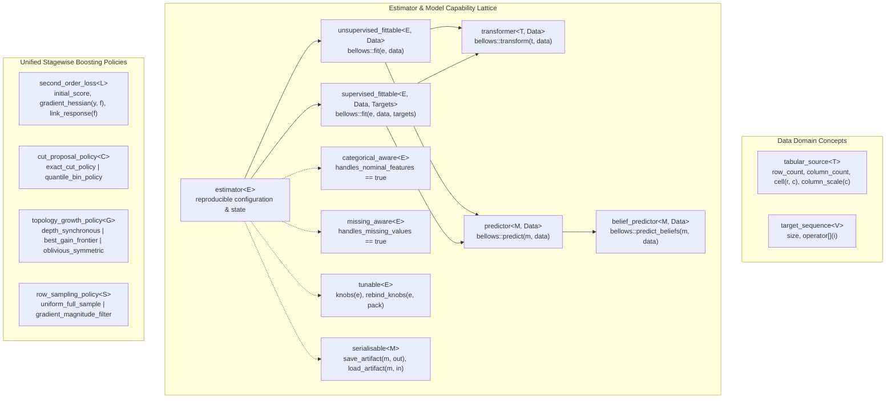

# Bellows Architectural Design Document and Implementation Plan

## 1. Exploration Note

An initial inspection of the workspace and host environment established the
following baseline facts and constraints:

- **Workspace Status**: The workspace directory
  (`.
  was initially empty.  No legacy source files, build scripts, or external
  vendored libraries were present.
- **Host Toolchain**:
  - **C++ Compiler**: `g++` (Debian 14.2.0-19) with full C++20 support
    (`-std=c++20`, `<concepts>`, `<ranges>`, `<span>`, `<bit>`, `<numbers>`).
  - **Build Tools**: GNU Make 4.4.1, CMake 3.31.6, GNU `ar`/`ranlib`,
    `pkg-config`, `tar`, `gzip`, and `python3` (usable for automated style and
    license header verification in `make check`).
- **Architectural & Legal Constraints**:
  - Licensed strictly under **GPLv3** with copyright attributed to
    `The Bellows Authors` (never the FSF or the GNU Project).
  - Adheres to the **GNU Coding Standards** strictly as a formatting, CLI, and
    build-target convention (`all`, `check`, `install`, `clean`, `dist`),
    while explicitly disclaiming any affiliation with the GNU Project or the
    Free Software Foundation.
  - Zero external non-standard dependencies required: a self-contained C++20
    design avoids license-compatibility hazards and guarantees deterministic
    builds of `libbellows.a`, `libbellows.so`, `bellows-check`, `bellows`,
    `bellows-train`, and `bellows-infer`.

---

## 2. Non-Derivative Ontology and Concept Lattice

### 2.1 Why Bellows Is Not a Port

The four reference libraries—Scikit-learn, XGBoost, LightGBM, and CatBoost—carry
deep architectural scars from their origins:

1. **Scikit-learn** relies on dynamically typed Python duck-typing paired with
   multiple-inheritance mixins (`BaseEstimator`, `ClassifierMixin`,
   `RegressorMixin`, `TransformerMixin`).  It mutates estimator objects
   in-place via `.fit(X, y)`, conflating immutable algorithm specifications
   with fitted model parameters, and treats missing values and categorical
   columns as errors unless pre-processed externally.
2. **XGBoost, LightGBM, and CatBoost** evolved as standalone C/C++ engines
   wrapped in opaque C handles (`BoosterHandle`, `DMatrixHandle`) configured by
   untyped string-to-string dictionaries (`"max_depth": "6"`,
   `"objective": "binary:logistic"`).  Each re-implements its own dataset
   container, objective loop, and tree structure rather than parameterising a
   single stagewise functional booster over orthogonal mathematical policies.

**Bellows replaces these idioms from first principles using C++20:**

- **Structural Capabilities via C++20 Concepts, Not Inheritance**: No class in
  Bellows inherits from an `estimator_base` or `mixin` class.  Whether an
  algorithm can fit, predict point estimates, predict probability beliefs,
  project/transform features, or assign clusters is determined purely by
  compile-time structural concepts.  A single algorithm (such as
  `centroid_partitioner` or `stagewise_booster`) naturally satisfies multiple
  concepts (`predictor` and `transformer`) without diamond inheritance.
- **Customization Point Objects (CPOs) and Pipe Composition**: Operations are
  expressed through free customization-point functions (`bellows::fit`,
  `bellows::predict`, `bellows::predict_beliefs`, `bellows::transform`,
  `bellows::evaluate`, `bellows::tune`) and composed via `operator|` into
  statically typed `composite_chain` pipelines (with opt-in type erasure via
  `dynamic_chain` only when heterogeneous runtime storage is needed).
- **Schema-Aware Tabular Domain Built on Hyper Math (`data_table` / `table_view`)**:
  Bellows builds its **Foundations: Data & Math** layer directly on the
  **Hyper Math** library (`<hyper_math/hyper_math.hpp>`):
  - `bellows::data_table` wraps a 64-byte aligned
    `hyper_math::tensor::nd_tensor<double>` storage slab and a 64-bit word
    `hyper_math::validity_bitmap` null/missing bitmask, and converts
    bidirectionally with `hyper_math::tabular::data_frame` and
    `hyper_math::tabular::series`.
  - Feature columns explicitly declare their measurement scale
    (`feature_scale::real`, `feature_scale::nominal`, `feature_scale::ordinal`)
    and represent missing entries natively (`hyper_math::constants::nan` and
    `validity_bitmap`).
  - Numerical linear algebra (`hyper_math::scientific::linalg::solve`),
    spatial metrics (`hyper_math::scientific::spatial::point_distance`),
    clustering (`hyper_math::scientific::cluster::kmeans2`), and stochastic
    sampling (`hyper_math::random_engine`) power Bellows' estimators and
    boosters.
- **Compile-Time Policy & Modifier Configuration**: Rather than untyped string
  maps or combinatorial template explosions, Bellows uses strong configuration
  descriptors (`with_booster<...>`, `with_regularisation`, `with_step_rate`,
  `with_tree_limits`, `with_ordered_categories`, `with_gradient_sampling`).

### 2.2 The Bellows Concept Lattice



### 2.3 Formal C++20 Concept Definitions

1. **`tabular_source<D>`**:
   Satisfied by `bellows::data_table` and zero-copy `bellows::table_view`.
   Provides `d.row_count()`, `d.column_count()`, `d.at(row, col)`,
   `d.scale(col)` (`feature_scale::real`, `nominal`, `ordinal`), and
   `d.cardinality(col)`.
2. **`estimator<E>`**:
   Any learning or preprocessing type `E` that is copy-constructible and
   exposes `e.is_calibrated() -> bool`.
3. **`unsupervised_fittable<E, D>`**:
   Refines `estimator<E>` and `tabular_source<D>`; requires
   `bellows::fit (e, d)` to calibrate `e` on unlabeled observations.
4. **`supervised_fittable<E, D, Y>`**:
   Refines `estimator<E>`, `tabular_source<D>`, and `target_sequence<Y>`;
   requires `bellows::fit (e, d, y)` to calibrate `e` on labeled observations.
5. **`predictor<M, D>`**:
   Refines `estimator<M>` and `tabular_source<D>`; requires
   `bellows::predict (m, d) -> std::vector<double>` (or discrete class labels)
   and single-observation low-latency `bellows::infer_one (m, row_span)`.
6. **`belief_predictor<M, D>`**:
   Refines `predictor<M, D>`; requires `bellows::predict_beliefs (m, d)`
   returning normalized class probability distributions per row.
7. **`transformer<T, D>`**:
   Refines `estimator<T>` and `tabular_source<D>`; requires
   `bellows::transform (t, d) -> data_table`.
8. **`categorical_aware<E>` & `missing_aware<E>`**:
   Compile-time capability concepts checking `E::supports_nominal_columns` and
   `E::supports_missing_entries`.  Pipelines and validators statically verify
   whether upstream mending/encoding is required or can be bypassed natively.
9. **`tunable<E>`**:
   Requires `e.parameter_space()` and `e.apply_parameter(name, value)`,
   enabling generic hyperparameter exploration (`grid_explorer`,
   `random_latin_explorer`) without string-eval hacks.
10. **`second_order_loss<L>`**:
    Requires `l.base_score(targets)`, `l.compute_derivatives(y, raw_score) ->
    derivative_pair{grad, hess}`, and `l.map_prediction(raw_score)`.
11. **`evaluation_metric<M>`**:
    Callable object `m(truth, prediction) -> double` with compile-time trait
    `M::maximise` (`true` for accuracy/$R^2$/AUC/F1/silhouette, `false` for
    MSE/MAE/log-loss/inertia).

### 2.4 Unified Stagewise Boosting Core

Instead of maintaining three separate gradient boosting engines, Bellows
implements a single `stagewise_booster<Loss, Cut_Policy, Growth_Policy,
Sampling_Policy>` template governed by four orthogonal policy axes and
configured via `with_*` modifiers:

| Policy Axis | Concrete Policies in Bellows | Mathematical Mechanism |
| :--- | :--- | :--- |
| **Cut Proposal (`Cut_Policy`)** | `exact_cut_policy` | Evaluates exact midpoints between sorted distinct feature values per node. |
| | `quantile_bin_policy` | Maps continuous columns into $B \le 255$ quantile buckets once; builds $(G, H)$ histograms in $O(n)$ and derives the larger sibling histogram via parent-minus-smaller subtraction in $O(B)$. |
| **Topology Growth (`Growth_Policy`)** | `depth_synchronous_growth` | Expands all frontier nodes at depth $d$ before depth $d+1$. |
| | `best_gain_frontier_growth` | Maintains a max-gain priority queue of active leaves, splitting the leaf with the highest penalised Newton gain up to `max_leaves`. |
| | `oblivious_symmetric_growth` | Selects one global `(feature, cut)` split per depth level $d$ across all $2^d$ nodes at that level, producing an oblivious decision table with branchless bitmask evaluation. |
| **Row Sampling (`Sampling_Policy`)** | `uniform_full_sample` | Retains all rows (or uniform subsample) per stage. |
| | `gradient_magnitude_filter` | Keeps top fraction $a$ of rows ordered by $|g_i|$ and randomly samples fraction $b$ of the remaining tail, scaling tail $(g_i, h_i)$ by $\frac{1-a}{b}$. |
| **Regularisation & Categorical Handling** | `with_regularisation` | Penalised Newton leaf weight $w^* = -\text{soft}(G, \alpha) / (H + \lambda)$ and split gain threshold $\gamma$. |
| | `with_ordered_categories` | Leakage-free online target statistics along a seeded permutation $\sigma$, plus optimal binary partitioning of nominal bins sorted by $G_{c} / (H_{c} + \lambda)$. |
| | Native Missing Routing | Every split node evaluates routing missing values (`NaN` / `missing_code`) both left and right, storing `missing_right` in the node. |

### 2.5 Capability Mapping from the Reference Libraries to Bellows

| Capability Domain | Reference Library Idiom (Not Used) | Bellows Non-Derivative Abstraction |
| :--- | :--- | :--- |
| **Core Fit / Predict / Transform** | `est.fit(X, y)`, `est.predict_proba(X)`, `est.fit_transform(X)` | Free CPOs `bellows::fit(est, tbl, y)`, `bellows::predict(est, tbl)`, `bellows::predict_beliefs(est, tbl)`, `bellows::transform(est, tbl)` |
| **Linear & Margin/Kernel Models** | `Ridge`, `Lasso`, `ElasticNet`, `LogisticRegression`, `SVC`, `KernelRidge` | `penalised_linear_regressor`, `penalised_logistic_classifier`, `max_margin_classifier`, `kernel_ridge_regressor` |
| **Neighbour & Density Models** | `KNeighborsClassifier`, `KNeighborsRegressor`, `GaussianNB` | `proximity_learner` (regression & classification), `gaussian_density_classifier` |
| **Bagged, Consensus & Stacked Ensembles** | `RandomForestClassifier`, `VotingClassifier`, `StackingClassifier` | `subspace_tree_ensemble`, `consensus_ensemble`, `stacked_generaliser` |
| **Clustering** | `KMeans`, `AgglomerativeClustering`, `DBSCAN` | `centroid_partitioner`, `hierarchical_partitioner`, `density_reachability_partitioner` |
| **Preprocessing, Projection & Missing Data** | `StandardScaler`, `MinMaxScaler`, `SimpleImputer`, `OneHotEncoder`, `KBinsDiscretizer`, `PCA`, `PolynomialFeatures` | `moment_normaliser`, `interval_rescaler`, `column_mender`, `indicator_expander`, `quantile_bucketer`, `principal_subspace_projector`, `interaction_expander` |
| **Feature Selection** | `VarianceThreshold`, `SelectKBest` | `dispersion_filter`, `relevance_selector` |
| **Pipelines** | `Pipeline([("scaler", ...), ("clf", ...)])` | `step_a \| step_b \| learner` producing `composite_chain<A, B, L>` or runtime `dynamic_chain` |
| **Model Selection & Tuning** | `KFold`, `StratifiedKFold`, `cross_val_score`, `GridSearchCV`, `RandomizedSearchCV` | `fold_splitter`, `stratified_splitter`, `grid_explorer`, `random_latin_explorer`, `evaluate(...)`, `tune(...)` |
| **Exact & Histogram GBDT** | `XGBClassifier(tree_method="exact" / "hist", reg_alpha, reg_lambda)` | `stagewise_booster` with `with_booster<exact_cut_policy, depth_synchronous_growth>` or `quantile_bin_policy` |
| **Leaf-wise & GOSS GBDT** | `LGBMClassifier(num_leaves, boosting_type="goss")` | `stagewise_booster` with `best_gain_frontier_growth` and `gradient_magnitude_filter` |
| **Symmetric Trees & Ordered Target Stats** | `CatBoostClassifier(depth, one_hot_max_size)` | `stagewise_booster` with `oblivious_symmetric_growth` and `with_ordered_categories` / `ordered_target_encoder` |

---

## 3. File and Directory Layout (GNU Conventions)

The repository follows the standard GNU source tree layout:

```text
bellows/
├── AGENTS.md                                    # Project rules & conventions
├── COPYING                                      # Full GPLv3 license text
├── README                                       # Overview, build guide, verbatim disclaimer
├── NEWS                                         # User-visible release notes
├── ChangeLog                                    # GNU-style change log
├── AUTHORS                                      # List of contributors
├── INSTALL                                      # Standard configure/make/install guide
├── Makefile                                     # Top-level GNU Makefile (all, check, install, clean, dist)
├── CMakeLists.txt                               # CMake configuration
├── bellows.pc.in                                # pkg-config file template
├── doc/
│   └── design.md                                # Architectural design & implementation plan (this file)
├── scripts/
│   └── check_style.py                           # Automated GNU style, header, and naming checker
├── include/
│   └── bellows/
│       ├── bellows.hpp                          # Umbrella convenience header
│       ├── version.hpp                          # Version macros and banner helpers
│       ├── core/
│       │   ├── concepts.hpp                     # C++20 concept lattice definitions
│       │   ├── data_table.hpp                   # Schema-aware table_view & data_table
│       │   ├── parameters.hpp                   # Tunable parameter descriptors & with_* modifiers
│       │   └── operations.hpp                   # CPOs: fit, predict, predict_beliefs, transform
│       ├── metrics/
│       │   └── metrics.hpp                      # Composable regression, classification, cluster metrics
│       ├── preprocess/
│       │   ├── scaling.hpp                      # moment_normaliser, interval_rescaler
│       │   ├── mending.hpp                      # column_mender (mean/median/mode imputation)
│       │   ├── encoding.hpp                     # indicator_expander, ordered_target_encoder, quantile_bucketer
│       │   ├── selection.hpp                    # dispersion_filter, relevance_selector
│       │   └── projection.hpp                   # principal_subspace_projector, interaction_expander
│       ├── estimators/
│       │   ├── linear.hpp                       # penalised_linear_regressor, penalised_logistic_classifier
│       │   ├── margin.hpp                       # max_margin_classifier, kernel_ridge_regressor
│       │   ├── proximity.hpp                    # proximity_learner (k-NN regressor/classifier)
│       │   ├── density.hpp                      # gaussian_density_classifier
│       │   ├── clustering.hpp                   # centroid, hierarchical, and density-reachability partitioners
│       │   └── forest.hpp                       # subspace_tree_ensemble (bagged random subspace trees)
│       ├── boosting/
│       │   ├── losses.hpp                       # squared_residual, huber_pseudo, logistic_bernoulli, multinomial
│       │   ├── policies.hpp                     # Cut, growth, sampling, and regularisation policies
│       │   └── booster.hpp                      # Unified stagewise_booster & oblivious/standard tree nodes
│       ├── composition/
│       │   ├── chain.hpp                        # Static composite_chain (operator|) & dynamic_chain
│       │   ├── ensemble.hpp                     # consensus_ensemble & stacked_generaliser
│       │   └── validation.hpp                   # fold_splitter, stratified_splitter, explorers, evaluate, tune
│       └── io/
│           └── artifact.hpp                     # Versioned binary serialisation & low-latency infer_one
├── src/
│   ├── libbellows.cpp                           # Library version, binary I/O helpers, shared tables
│   ├── cli_common.hpp                           # GNU --help, --version, and CSV/table loader for CLIs
│   ├── bellows_main.cpp                         # Main `bellows` CLI (inspect, evaluate, info)
│   ├── bellows_train_main.cpp                   # `bellows-train` CLI executable
│   └── bellows_infer_main.cpp                   # `bellows-infer` CLI executable
├── tests/
│   ├── check_main.cpp                           # `bellows-check` test runner & assertion harness
│   ├── test_core.cpp                            # Concept lattice, data_table, missing/nominal traits
│   ├── test_preprocess.cpp                      # Scaling, mending, ordered encoding, bucketing, selection
│   ├── test_estimators.cpp                      # Linear, logistic, proximity, density, clustering, forest
│   ├── test_boosting.cpp                        # Exact/hist cuts, depth/leaf/oblivious growth, GOSS, ordered cats
│   ├── test_composition.cpp                     # Pipe chains, dynamic chains, cross-validation, tuning, metrics
│   └── test_io_and_cli.cpp                      # Binary artifact persistence and low-latency inference
└── examples/
    └── workflow_demo.cpp                        # End-to-end C++20 pipeline & boosting demonstration
```

---

## 4. Implementation Plan and Verification Loop

Each component will be implemented strictly in order, accompanied by its unit
tests in `bellows-check` and verified via `make check` before advancing to the
next component.

### Phase 1: Repository Scaffolding, GNU Build System, and Style Enforcer
- **Deliverables**:
  - `COPYING` (full GPLv3 text), `README` (with verbatim required disclaimer),
    `NEWS`, `ChangeLog`, `AUTHORS`, `INSTALL`, `bellows.pc.in`.
  - `Makefile` and `CMakeLists.txt` supporting `all`, `check`, `install`,
    `clean`, and `dist`, building `libbellows.a`, `libbellows.so`,
    `bellows-check`, `bellows`, `bellows-train`, and `bellows-infer`.
  - `scripts/check_style.py` validating GPLv3 notices, absence of FSF/GNU
    affiliation claims, absence of `gnu-` prefixes, no tabs in C++ sources, and
    GNU formatting conventions.
- **Verification Step**:
  - Run `make check` with minimal skeleton `bellows-check` and CLI binaries
    verifying `--help`, `--version`, `bellows.pc` generation, and style check.

### Phase 2: Core Concept Lattice, Tabular Domain, and Metrics
- **Deliverables**:
  - `include/bellows/core/concepts.hpp`, `data_table.hpp`, `parameters.hpp`,
    `operations.hpp`.
  - `include/bellows/metrics/metrics.hpp` (MSE, RMSE, MAE, $R^2$, accuracy,
    balanced F1, log-loss, ROC-AUC, inertia, silhouette).
  - `tests/test_core.cpp`.
- **Verification Step**:
  - Run `make check` to verify static concept satisfaction (`static_assert`),
    nominal/ordinal/real column schemas, native `NaN`/`missing_code` handling,
    and metric accuracy on analytical test cases.

### Phase 3: Unified Stagewise Boosting Core and Policies
- **Deliverables**:
  - `include/bellows/boosting/losses.hpp`, `policies.hpp`, `booster.hpp`.
  - Implementation of `stagewise_booster` supporting:
    - Objectives: `squared_residual_loss`, `huber_pseudo_loss`,
      `logistic_bernoulli_loss`, `multinomial_deviance_loss`.
    - Cut policies: `exact_cut_policy` and `quantile_bin_policy` (with
      histogram subtraction).
    - Growth policies: `depth_synchronous_growth`,
      `best_gain_frontier_growth` (leaf-wise), and
      `oblivious_symmetric_growth` (symmetric trees).
    - Sampling policies: `uniform_full_sample` and
      `gradient_magnitude_filter`.
    - Native missing value routing (`missing_right`) and ordered target
      statistics (`with_ordered_categories`) for nominal columns.
  - `tests/test_boosting.cpp`.
- **Verification Step**:
  - Run `make check` testing all combinations of cut, growth, and sampling
    policies on synthetic regression, binary, and multiclass problems,
    including datasets with missing entries and high-cardinality nominal
    features.

### Phase 4: Preprocessing and Feature Engineering Transformers
- **Deliverables**:
  - `include/bellows/preprocess/scaling.hpp` (`moment_normaliser`,
    `interval_rescaler`).
  - `include/bellows/preprocess/mending.hpp` (`column_mender` with mean,
    median, and most-frequent strategies).
  - `include/bellows/preprocess/encoding.hpp` (`indicator_expander`,
    `ordered_target_encoder`, `quantile_bucketer`).
  - `include/bellows/preprocess/selection.hpp` (`dispersion_filter`,
    `relevance_selector`).
  - `tests/test_preprocess.cpp`.
- **Verification Step**:
  - Run `make check` verifying each transformer's calibration, transformation,
    and invariance properties on real, nominal, and missing-value columns.

### Phase 5: Classical Estimators (Linear, Proximity, Density, Clustering, Forest)
- **Deliverables**:
  - `include/bellows/estimators/linear.hpp` (`penalised_linear_regressor`,
    `penalised_logistic_classifier` with $L_1$/$L_2$ penalties).
  - `include/bellows/estimators/proximity.hpp` (`proximity_learner` for k-NN
    regression and classification).
  - `include/bellows/estimators/density.hpp` (`gaussian_density_classifier`).
  - `include/bellows/estimators/clustering.hpp` (`centroid_partitioner`
    satisfying both `predictor` and `transformer`).
  - `include/bellows/estimators/forest.hpp` (`subspace_tree_ensemble`).
  - `tests/test_estimators.cpp`.
- **Verification Step**:
  - Run `make check` verifying convergence, predictions, probability beliefs,
    and dual predictor/transformer roles.

### Phase 6: Composition Chains, Cross-Validation, and Hyperparameter Exploration
- **Deliverables**:
  - `include/bellows/composition/chain.hpp` (`composite_chain` with
    `operator|` and type-erased `dynamic_chain`).
  - `include/bellows/composition/validation.hpp` (`fold_splitter`,
    `stratified_splitter`, `cross_validate`, `parameter_sweep`).
  - `tests/test_composition.cpp`.
- **Verification Step**:
  - Run `make check` verifying multi-stage pipelines (`mender | normaliser |
    selector | booster`), dynamic runtime chains, stratified k-fold
    cross-validation, and automated hyperparameter tuning over `tunable`
    estimators.

### Phase 7: Versioned Binary Serialisation, Low-Latency Inference, and CLI Tools
- **Deliverables**:
  - `include/bellows/io/artifact.hpp` (`save_artifact`, `load_artifact`,
    checksum verification, and zero-allocation `infer_one`).
  - Complete implementations of `bellows`, `bellows-train`, and `bellows-infer`
    in `src/`, plus `examples/workflow_demo.cpp` and `tests/test_io_and_cli.cpp`.
- **Verification Step**:
  - Run `make check`, `make dist`, and end-to-end CLI round-trip tests
    (`bellows-train` -> binary `.blws` model -> `bellows-infer` -> `bellows`
    inspection), confirming 100% test pass rate and zero style violations.
