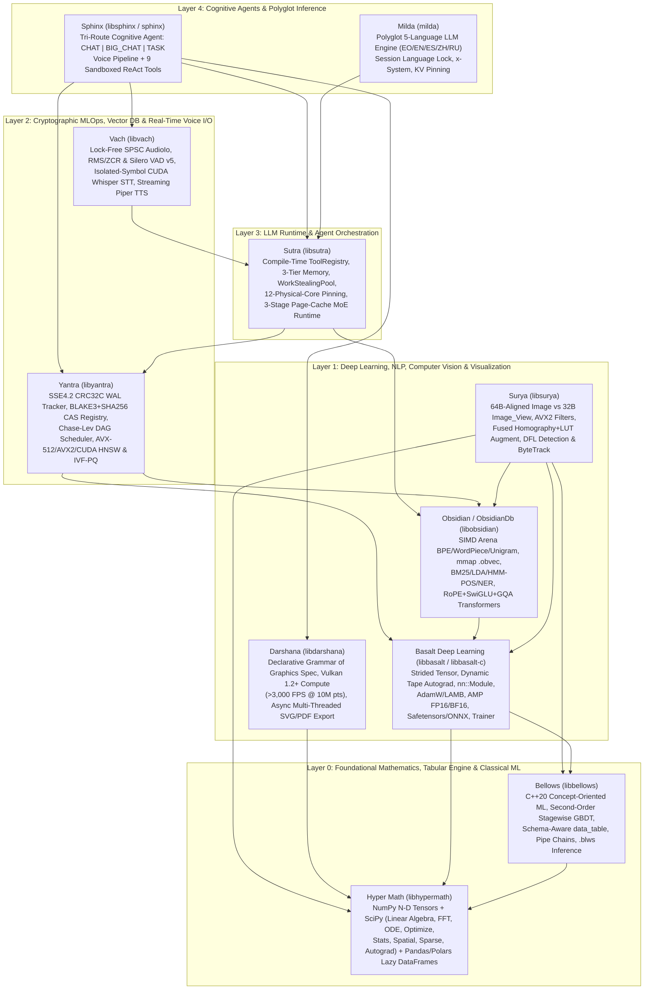

# Arkantos AI Stack Suite — Comprehensive Architectural & Engineering Reference Manual

**Version:** 1.0.0 (`2026-11-09`)  
**Author & Copyright:** Copyright (C) 2026 **Kival**  
**License (Code & Documentation):** GNU General Public License v3.0 or later (`GPL-3.0-or-later`) with Section 7 Runtime & Hardware Compute Library Exception  
**Reference Workstation (`Silver`):** Debian GNU/Linux 13 (Trixie, Kernel `6.12`), 12th Gen Intel Core i7-12700K (`8 P-cores + 4 E-cores = 12 physical cores / 20 threads`), `48 GiB` Dual-Channel DDR4 RAM (`~40.3 GiB/s`), NVIDIA GeForce RTX 3070 (`8 GiB` GDDR6 VRAM, Compute Capability `8.6`, CUDA `12.4`)

> **Copyright & GPLv3 Documentation Notice**  
> Copyright (C) 2026 **Kival**.  
> This documentation and the entire **Arkantos AI Stack Suite** are free software and free documentation: you can redistribute them and/or modify them under the terms of the **GNU General Public License** as published by the Free Software Foundation, either version 3 of the License, or (at your option) any later version (`GPL-3.0-or-later`), including the **Section 7 Runtime & Hardware Compute Library Exception** described in [Section 15](#15-gplv3--section-7-runtime--hardware-compute-library-exception).  
> The Arkantos AI Stack Suite is an independent software collection; it follows the **GNU Coding Standards** strictly as an engineering, formatting, and verification discipline and is not affiliated with or endorsed by the Free Software Foundation.

---

## Table of Contents

1. [Executive Summary & System Taxonomy](#1-executive-summary--system-taxonomy)
2. [Global Architectural Decisions & Engineering Rationale ("Why")](#2-global-architectural-decisions--engineering-rationale-why)
3. [Layer 0.1 — `Hyper Math` (`libhypermath`): Numerical, Scientific & Columnar Engine](#3-layer-01--hyper-math-libhypermath-numerical-scientific--columnar-engine)
4. [Layer 0.2 — `Bellows` (`libbellows`): Concept-Oriented Classical Machine Learning](#4-layer-02--bellows-libbellows-concept-oriented-classical-machine-learning)
5. [Layer 1.1 — `Basalt Deep Learning` (`libbasalt`): Dynamic Autograd & Neural Networks](#5-layer-11--basalt-deep-learning-libbasalt-dynamic-autograd--neural-networks)
6. [Layer 1.2 — `Obsidian` / `ObsidianDb` (`libobsidian`): Classical & Neural NLP Engine](#6-layer-12--obsidian--obsidiandb-libobsidian-classical--neural-nlp-engine)
7. [Layer 1.3 — `Surya` (`libsurya`): SIMD/CUDA Computer Vision & Detection Engine](#7-layer-13--surya-libsurya-simdcuda-computer-vision--detection-engine)
8. [Layer 1.4 — `Darshana` (`libdarshana`): Vulkan GPU & Vector Statistical Visualization](#8-layer-14--darshana-libdarshana-vulkan-gpu--vector-statistical-visualization)
9. [Layer 2.1 — `Yantra` (`libyantra`): Cryptographic MLOps, DAG Scheduler & Vector DB](#9-layer-21--yantra-libyantra-cryptographic-mlops-dag-scheduler--vector-db)
10. [Layer 2.2 — `Vach` (`libvach`): Lock-Free Real-Time Audio, VAD, Whisper STT & Piper TTS](#10-layer-22--vach-libvach-lock-free-real-time-audio-vad-whisper-stt--piper-tts)
11. [Layer 3.1 — `Sutra` (`libsutra`): Hybrid MoE LLM Runtime & Agent Orchestration](#11-layer-31--sutra-libsutra-hybrid-moe-llm-runtime--agent-orchestration)
12. [Layer 4.1 — `Sphinx` (`sphinx`): Tri-Route Cognitive Voice & ReAct Engineering Agent](#12-layer-41--sphinx-sphinx-tri-route-cognitive-voice--react-engineering-agent)
13. [Layer 4.2 — `Milda` (`milda`): Polyglot 5-Language & Esperanto C++23 Inference Engine](#13-layer-42--milda-milda-polyglot-5-language--esperanto-c23-inference-engine)
14. [Layer 5 — `Stack Test` (`stack_integration_test`): Full-Stack Composability Proof](#14-layer-5--stack-test-stack_integration_test-full-stack-composability-proof)
15. [GPLv3 + Section 7 Runtime & Hardware Compute Library Exception](#15-gplv3--section-7-runtime--hardware-compute-library-exception)
16. [Complete Dependency Order Build, Verification & Mirror Synchronization Guide](#16-complete-dependency-order-build-verification--mirror-synchronization-guide)

---

## 1. Executive Summary & System Taxonomy

The **Arkantos AI Stack Suite** is a clean-room, vertically integrated **C++20/C++23** artificial intelligence, scientific computing, MLOps, multimodal perception, and autonomous agent stack. It replaces the fragmented Python AI ecosystem (`NumPy`, `SciPy`, `Pandas`, `Polars`, `scikit-learn`, `XGBoost`, `LightGBM`, `PyTorch`, `Hugging Face Transformers`, `spaCy`, `NLTK`, `Gensim`, `OpenCV`, `Albumentations`, `Ultralytics`, `Matplotlib`, `Seaborn`, `Plotly`, `MLflow`, `Prefect`, `FAISS`, `Fairlearn`, `LangChain`, `LlamaIndex`, `AutoGen`) with **11 native C++ libraries/engines and 1 end-to-end composability verification harness**.

### 1.1 Architectural Layer Diagram



### 1.2 Master Component Matrix

| Layer | Component | Binary / Targets | Standard | Python Rivals Replaced | Cold-Start / Key Throughput Metric |
| :---: | :--- | :--- | :---: | :--- | :--- |
| **0.1** | **[Hyper Math](./Hyper%20Math)** | `libhypermath.so`, `libhypermath.a`, `hyper-math` | C++20 | NumPy, SciPy, Pandas, Polars | `64B`-aligned slab tensors, lazy predicate/projection pushdown |
| **0.2** | **[Bellows](./Bellows)** | `libbellows.so`, `libbellows.a`, `bellows`, `bellows-train`, `bellows-infer` | C++20 | scikit-learn, XGBoost, LightGBM, CatBoost | Zero-allocation single-row `.blws` inference (`bellows::infer_one`) |
| **1.1** | **[Basalt Deep Learning](./Basalt%20Deep%20Learning)** | `libbasalt.so`, `libbasalt.a`, `basalt-train`, `basalt-inspect`, `basalt-convert` | C++20 / C99 | PyTorch, PyTorch Lightning, TorchMetrics | Reverse-mode dynamic tape autograd, AMP `fp16`/`bf16`, C99 ABI |
| **1.2** | **[Obsidian (`ObsidianDb`)](./Obsidian)** | `libobsidian.so`, `libobsidian.a`, `obsidian-nlp` | C++23 | Hugging Face Tokenizers/Transformers, spaCy, NLTK, Gensim | Zero-heap-allocation `Arena` BPE, $O(1)$ `mmap` `.obvec` & `.safetensors` |
| **1.3** | **[Surya](./Surya)** | `libsurya.a` | C++23 | OpenCV, Torchvision, Albumentations, Ultralytics YOLO | `64B` row-aligned SIMD images, fused $3\times 3$ homography + `768B` L1 LUT |
| **1.4** | **[Darshana](./Darshana)** | `libdarshana.a` | C++23 | Matplotlib, Seaborn, Plotly, Bokeh | `2.27 ms` cold start, `4.34 MB` RSS, `>3,000 FPS` @ 10M pts (Vulkan) |
| **2.1** | **[Yantra](./Yantra)** | `libyantra.so.1.0.0`, `Yantra::Yantra` | C++23 | MLflow, Prefect/Airflow, FAISS, Fairlearn | `< 0.5 ms` 10k-run zone-map query, hardware `SHA-NI` + `BLAKE3` CAS |
| **2.2** | **[Vach](./Vach)** | `libvach.so.0.1.0`, `Vach::Vach` | C++23 | PyAudio, Silero-Python, Whisper-Python, Piper-Python | `200 ms` VAD endpoint, `0.037 ms` STT loopback, `< 1 µs` barge-in flush |
| **3.1** | **[Sutra](./Sutra)** | `libsutra.so.0.1.0`, `Sutra::Sutra` | C++23 | LangChain, LlamaIndex, PydanticAI, CrewAI, AutoGen | `0.38 ms` cold start, `4.59 MB` RSS, `0.95 s` 38.5 GiB MoE warm preload |
| **4.1** | **[Sphinx](./Sphinx)** | `libsphinx.so`, `sphinx`, `sphinx-text` | C++23 | OpenAI Voice/Code Agents, Claude Code, Aider | `CHAT`: `211.5 tok/s`; `BIG_CHAT`: `22.6 tok/s` (`MAJFL=0`, `1200%` CPU) |
| **4.2** | **[Milda](./Milda)** | `milda` (`build/` CUDA & `build-cpu/` portable) | C++23 | Ollama CLI, LM Studio CLI, Text-Generation-WebUI | `65–80+ tok/s` (7B GPU), `25–38 tok/s` (30B MoE), 5-language lock |
| **5.0** | **[Stack Test](./Stack%20Test/stack-integration)** | `stack_integration_test` | C++23 | End-to-End Integration Verification | `7/7` hard composability gates verified against live 7B GGUF |

---

## 2. Global Architectural Decisions & Engineering Rationale ("Why")

Every design decision across the Arkantos AI Stack Suite was made to solve concrete systems-engineering pathologies observed in Python-based and legacy C++ AI stacks on hybrid workstation hardware (`48 GiB` host RAM + `8 GiB` GPU VRAM + heterogeneous P-core/E-core CPUs).

### 2.1 Decision 1: Why Zero-Python Pure C++20/C++23?
- **The Problem:** Python AI stacks suffer from five structural bottlenecks:
  1. **Global Interpreter Lock (GIL) & Multi-Process Duplication:** Workarounds like `multiprocessing` duplicate page tables and serialize tensors over IPC pipes, exhausting RAM when hosting 42+ GiB MoE models.
  2. **Cold-Start & Baseline Memory Bloat:** Importing `torch`, `transformers`, `scipy`, and `mlflow` consumes `400–900 MiB` of RSS and `2–6 seconds` of startup latency before a single operation runs.
  3. **Garbage Collection & Heap Fragmentation:** Per-turn dictionary, list, and string allocations fragment the heap and cause unpredictable latency spikes during real-time voice streaming (`< 200 ms` barge-in budgets).
  4. **Dynamic Schema & Duck-Typing Fragility:** Malformed tool schemas or silent `NaN` broadcasts only fail mid-inference after expensive GPU prefills.
- **The Arkantos Solution:** By writing the entire stack in C++20/C++23 with compile-time concepts (`bellows::estimator`, `obsidian::Stemmer_Policy`), compile-time function-pointer tool reflection (`SUTRA_REGISTER_TOOL`), and pre-allocated arenas, cold-start latency drops to **`0.38 ms` (`4.59 MB` RSS)** in `Sutra` and **`2.27 ms` (`4.34 MB` RSS)** in `Darshana`, while multi-agent and multi-tool execution scales lock-freely across all physical CPU cores inside a single process address space.

### 2.2 Decision 2: Why Strict GNU Coding Standards & Allman Formatting (`check_gnu_style`)?
- **The Problem:** Large multi-repository C++ codebases frequently degenerate into inconsistent formatting, hidden raw pointer ownership (`new`/`delete`), unbounded line lengths, and platform-specific compiler hacks.
- **The Arkantos Solution:** Every `.cpp`, `.hpp`, and `.h` file across all repositories adheres to the **GNU Coding Standards** with **Allman brace placement** (every `{` and `}` on its own line, indented 2 spaces in GNU style), space before `(` in function calls (`foo (x)`), `<= 79` (or component-configured) column width, zero tab characters, and zero trailing whitespace.
- **Automated Gate:** Every component includes an automated style and safety verifier (`check_gnu_style` / `check_style.py`) executed inside `ctest` / `make check` that statically rejects raw `new`/`delete` outside low-level slab/arena allocators and enforces formatting uniformity across all 11 components.

### 2.3 Decision 3: Why `std::expected<T, Error>` (`Result<T>`) Instead of C++ Exceptions?
- **The Problem:** C++ exceptions incur non-deterministic stack-unwinding overhead on error paths, cannot safely cross C ABI or shared-library (`dlopen`) boundaries, and hide failure modes from function signatures.
- **The Arkantos Solution:** Every fallible function across `Basalt`, `Obsidian`, `Darshana`, `Yantra`, `Vach`, `Sutra`, and `Sphinx` is annotated `[[nodiscard]]` and returns `Result<T>` (`std::expected<T, Error>`). Errors are strongly typed algebraic sum types (e.g., `yantra::Error` wrapping `std::variant<TrackingError, RegistryError, DagError, IndexError, FairnessError>`, and `sutra::AgentError` wrapping `std::variant<LlmError, ToolError, PlanningError, FrameworkError>`). Cross-library seams translate errors losslessly (verified by `CHECK-4` in `stack_integration_test`, where a `yantra::RegistryError` propagates through `sutra::LlamaCppClient::create_from_registry` with its original error code intact).

### 2.4 Decision 4: Why Strict Pimpl & Header Symbol Isolation?
- **The Problem:** Including backend headers (`llama.h`, `ggml.h`, `whisper.h`, `onnxruntime_c_api.h`, `cuda_runtime.h`, `vulkan/vulkan.h`, `alsa/asoundlib.h`) in public C++ headers leaks thousands of C macros and global symbols into consumer translation units, slows compilation by 5–10x, and causes ODR/symbol clashes when linking multiple inference engines (`llama.cpp` + `whisper.cpp` both define `ggml_*` symbols!).
- **The Arkantos Solution:**
  1. All public headers (`include/sutra/*.hpp`, `include/vach/*.hpp`, `include/yantra/*.hpp`, `include/darshana/*.hpp`) compile with **only** the C++23 standard library and stack-internal headers.
  2. All third-party and hardware backends live strictly inside `.cpp`/`.cu` implementation files behind `std::unique_ptr<Impl>` Pimpl handles.
  3. In `Vach`, `libwhisper.so` is linked or loaded with isolated symbol visibility (`RTLD_LOCAL` / `-fvisibility=hidden`) so its internal `ggml` symbols never collide with `Sutra`'s `libllama.so` / `libggml-cpu.so` in `Sphinx`.
  4. Automated tests (`test_vach_header_symbol_isolation`, `test_sutra_header_isolation`) inspect preprocessed translation units to prove zero leaked backend symbols.

### 2.5 Decision 5: Why 64-Byte Cache-Line Alignment & `std::pmr` Monotonic Arenas?
- **The Problem:** Standard `std::allocator` (`malloc`) returns 16-byte aligned pointers on x86_64 Linux, causing unaligned AVX2 (`32B`) and AVX-512 (`64B`) vector loads/stores, cache-line splits at image row boundaries, and false sharing when worker threads update adjacent atomic counters.
- **The Arkantos Solution:**
  - `Hyper Math` (`slab_buffer<T>`), `Surya` (`SURYA_CACHELINE_BYTES = 64` scanline pitch padding), `Obsidian` (`.obvec` 64-byte aligned embedding tables), `Yantra` (`alignas(64) WalRecord`, `ChaseLevDeque`), `Vach` (`alignas(64)` SPSC ring buffer indices), and `Sutra` (`alignas(64) LockFreeQueue`) enforce 64-byte alignment at the hardware cache-line boundary.
  - Hot-path temporary allocations (`Obsidian::BPE_Tokenizer::encode_into_arena`, `Darshana::ScratchArena`, `Sutra::InferenceArena`) use stack- or vector-backed `std::pmr::monotonic_buffer_resource` arenas that bump a pointer in $O(1)$ (`~1.2 ns`) and reset in $O(1)$ at the end of each turn or frame.

---

## 3. Layer 0.1 — `Hyper Math` (`libhypermath`): Numerical, Scientific & Columnar Engine

- **Location:** [`$HOME/AI/Arkantos/Hyper Math`](Hyper%20Math)
- **Public Headers:** [`include/hyper_math/hyper_math.hpp`](Hyper%20Math/include/hyper_math/hyper_math.hpp), [`include/hyper_math/hyper_math_c.h`](Hyper%20Math/include/hyper_math/hyper_math_c.h)
- **Installed Artifacts:** `libhypermath.so`, `libhypermath.a`, `bin/hyper-math`, `lib/pkgconfig/hyper-math.pc`

### 3.1 Complete Feature Specification Across All 3 Subsystems

#### Subsystem A: `hyper_math::tensor` (NumPy Equivalent)
1. **Rank-Agnostic Affine Lattice & `slab_buffer<T>`**:
   - Reference-counted, 64-byte cache-line aligned memory slabs supporting arbitrary $N$-dimensional shapes and signed element/byte strides.
   - Zero-copy views (`slice`, `transpose`, `swapaxes`, `reshape`, `squeeze`, `expand_dims`, `broadcast_to`, `sliding_window_view`) that mutate only the affine descriptor $(offset, shape, strides)$ without copying payload bytes.
2. **Lazily Fused Morphism Expression Templates (`ufunc`)**:
   - Arithmetic (`+`, `-`, `*`, `/`) and transcendental functions (`sin`, `cos`, `tan`, `asin`, `acos`, `atan`, `atan2`, `sinh`, `cosh`, `tanh`, `exp`, `expm1`, `log`, `log1p`, `log2`, `log10`, `sqrt`, `cbrt`, `pow`, `abs`, `floor`, `ceil`, `round`, `clip`, `where`) compose into compile-time C++20 expression trees evaluated in a single allocation-free AVX2+FMA loop.
3. **Reductions, Array Manipulation, Contractions & Serialization**:
   - Full, axis-wise, and `NaN`-safe reductions: `sum`/`nansum`, `prod`/`nanprod`, `mean`/`nanmean`, `var`/`nanvar`, `std_dev`/`nanstd`, `min`/`nanmin`, `max`/`nanmax`, `argmin`/`nanargmin`, `argmax`/`nanargmax`, `cumsum`/`nancumsum`, `cumprod`/`nancumprod`, `median`/`nanmedian`, `percentile`/`nanpercentile`, `quantile`/`nanquantile`, `all`, `any`.
   - Array manipulation & statistics: `meshgrid`, `tile`, `repeat`, `pad`, `flip`, `roll`, `rot90`, `tril`, `triu`, `diag`, `vander`, `searchsorted`, `bincount`, `histogram`, `histogram2d`, `histogramdd`, `gradient`, `cov`, `corrcoef`, `polyfit`, `polyval`, `polyder`, `polyint`, `polydiv`, `roots`.
   - Tensor contractions: AVX2 cache-blocked `matmul`, `dot`, `vdot`, `inner`, `outer`, `kron`, `tensordot`, `multi_dot`, and generalized Einstein summation (`einsum`, `einsum_path`).
   - Binary I/O: NumPy `.npy` and compressed/uncompressed `.npz` archive reader/writer (`save_npy`, `load_npy`, `save_npz`, `load_npz`).

#### Subsystem B: `hyper_math::scientific` (SciPy Equivalent)
1. **`linalg` (Dense & Structured Linear Algebra)**:
   - Decompositions: Partial-pivoting LU (`lu_factor`, `lu_solve`, `lu`), symmetric indefinite Bunch-Kaufman/rook `ldl`, Householder QR & column-pivoted QR (`qr`, `qr_pivoted`, `rq`, `qz`), Cholesky (`cholesky`, `cho_solve`), upper Hessenberg (`hessenberg`), real/complex Schur (`schur`, `rsf2csf`), symmetric tridiagonal & general eigensolvers (`eigh`, `eigh_generalized`, `eigh_tridiagonal`, `eig`, `eigvals`), Golub-Kahan/Jacobi SVD (`svd`, `svdvals`, `diagsvd`, `subspace_angles`, `orth`, `null_space`), Moore-Penrose pseudoinverse (`pinv`), `det`, `slogdet`, `inv`, `lstsq`.
   - Matrix functions: Padé scaling-and-squaring matrix exponential & Fréchet derivative (`expm`, `expm_frechet`), Schur-Parlett general matrix function (`funm`), `fractional_matrix_power`, `sqrtm`, `logm_spd`, `cosm`, `sinm`, `tanm`, `coshm`, `sinhm`, `tanhm`, `signm`, `polar`.
   - Banded & Matrix Equation Solvers: `solve_banded`, `cholesky_banded`, `solve_triangular`, Bartels-Stewart Sylvester solver (`solve_sylvester`), continuous/discrete Lyapunov (`solve_continuous_lyapunov`, `solve_discrete_lyapunov`), and Algebraic Riccati equations (`solve_continuous_are`, `solve_discrete_are`).
   - Special & Structured Matrices: `toeplitz` (with Levinson-Durbin $O(n^2)$ solver `solve_toeplitz`), `circulant`, `hankel`, `hilbert`, `invhilbert`, `hadamard`, `companion`, `leslie`, `fiedler`, `pascal`, `helmert`, `dft_matrix`, `khatri_rao`, `clarkson_woodruff_transform`.
2. **`fft` (Spectral Transforms)**:
   - Mixed-radix Cooley-Tukey (power-of-two and composite $2^a 3^b 5^c$) + Bluestein Chirp-Z prime-length 1D, 2D, and $N$-D complex/real/Hermitian FFTs (`fft`, `ifft`, `rfft`, `irfft`, `hfft`, `ihfft`, `fft2`, `ifft2`, `rfft2`, `irfft2`, `fftn`, `ifftn`, `rfftn`, `irfftn`).
   - Type I–IV Discrete Cosine & Sine Transforms (`dct`, `idct`, `dct2`, `idct2`, `dst`, `idst`), Fast Hankel Transform (`fht`, `ifht`), and `convolve_fft`.
3. **`integrate` (Quadrature, ODEs & BVPs)**:
   - Quadrature: Adaptive 15-point Gauss-Kronrod (`quad`, `quad_vec`, `dblquad`, `tplquad`, `nquad`), double-exponential `tanhsinh`, Romberg extrapolation, Gauss-Legendre, composite Simpson's & trapezoidal rules.
   - ODE & BVP Solvers: Explicit Dormand-Prince `RK45`, Bogacki-Shampine `RK23`, 8th-order `DOP853`, and stiff implicit `Radau` IIA / `BDF` solvers with zero-crossing event detection (`solve_ivp`, `solve_ivp_events`), plus collocation two-point boundary-value solver (`solve_bvp`).
4. **`optimize` (Root Finding, Nonlinear, LP/MILP & Global Optimization)**:
   - Root Finding: `brentq`, `brenth`, `ridder`, `secant`, `halley`, `fixed_point`, Powell hybrid `fsolve`, Broyden's good method (`broyden1`).
   - Continuous Optimization: `BFGS`, `L-BFGS-B` (box-constrained), Polak-Ribière `CG`, `Newton-CG`, `Powell`, `Dogleg`, `Trust-NCG`, `Nelder-Mead`, and `SLSQP` (constrained sequential least-squares quadratic programming).
   - Least Squares & Linear/Integer Programming: Levenberg-Marquardt (`least_squares_lm`), trust-region reflective bounded least squares (`least_squares_bounds`), `curve_fit`, active-set `nnls`, `lsq_linear`, two-phase Simplex `linprog`, branch-and-bound `milp`, Hungarian `linear_sum_assignment`, and FAQ `quadratic_assignment`.
   - Global Optimization: `dual_annealing`, `differential_evolution`, `basinhopping`, simplicial homology `shgo`, and dividing rectangles `direct`.
5. **`stats` (Special Functions, Distributions, QMC & Hypothesis Tests)**:
   - 45+ Special Functions: Lanczos $\Gamma(z)$, $\ln\Gamma(z)$, digamma $\psi(z)$, polygamma $\psi^{(m)}(z)$, incomplete gamma/beta, $\text{erf}$, $\text{erfc}$, $\text{erfinv}$, Dawson, Fresnel $S(x)/C(x)$, $\text{Si}/\text{Ci}/\text{Ei}$, Spence dilogarithm, Lambert $W_0/W_{-1}$, Wright $\omega$, Riemann/Hurwitz $\zeta(s,q)$, Airy $\text{Ai}/\text{Bi}$, Bessel $J_\nu, Y_\nu, I_\nu, K_\nu$, spherical Bessel, associated Legendre $P_\ell^m$, spherical harmonics $Y_\ell^m$, Chebyshev/Hermite/Laguerre/Jacobi polynomials, Gauss hypergeometric ${}_2F_1$ & confluent ${}_1F_1$, complete elliptic integrals $K(m), E(m)$.
   - 22 Probability Distributions (PDF, CDF, PPF/quantile, log-PDF, random sampling, MLE fit) including `multivariate_normal_dist`, `dirichlet_dist`, and `wishart_dist`.
   - Quasi-Monte Carlo (`qmc`): Scrambled `halton`, direction-number `sobol`, `latin_hypercube`, `poisson_disk`, and $L_2$-star `discrepancy`.
   - 25+ Statistical Tests: Student's $t$-tests (1-sample, 2-sample, Welch, paired), Mann-Whitney $U$, Wilcoxon signed-rank, Kruskal-Wallis, Friedman, Kolmogorov-Smirnov (1-sample & 2-sample), Shapiro-Wilk, Anderson-Darling, Pearson $r$, Spearman $\rho$, Kendall $\tau$, $\chi^2$, Fisher exact, one-way ANOVA, Tukey HSD, Levene, Bartlett, plus Gaussian KDE and PCA.
6. **`spatial`, `cluster`, `interpolate`, `signal`, `sparse`, `autograd`**:
   - Spatial & Clustering: $k$-d tree (`kd_tree`), 15-metric `cdist`/`pdist`, 2D Graham/Monotone Chain Convex Hull, Bowyer-Watson `delaunay_2d`, Voronoi & Spherical Voronoi, Sutherland-Hodgman halfspace/polygon clipping, 3D `rotation` (quaternions, SLERP, Kabsch SVD alignment), $k$-Means++ (`kmeans2`), Ward/single/complete/average hierarchical `linkage`, `dbscan`, and `optics`.
   - Interpolation, Signal & Sparse: Cubic/Akima/PCHIP/B-splines (`bspline`), thin-plate/multiquadric RBF, Bilinear/Trilinear grids; Butterworth/Chebyshev/Elliptic/Bessel IIR & windowed FIR filters, second-order sections (`sosfilt`, zero-phase `sosfiltfilt`), Welch PSD, Lomb-Scargle periodogram, STFT/ISTFT, LTI state-space (`lsim`, `step_response`, `bode`); CSR/CSC/COO/DIA/BSR/DOK/LIL sparse matrices with CG, BiCGSTAB, GMRES, MINRES, LSQR, ILU(0) preconditioner, Lanczos `eigsh`/`svds`, and Dijkstra/Bellman-Ford/Floyd-Warshall/MST `csgraph`.
   - Forward & Reverse Autograd: Forward-mode `dual_number<T>` and reverse-mode Wengert `tape` computing exact gradients (`grad`), Jacobians (`jacobian`), Hessians (`hessian`), and autograd-driven BFGS (`minimize_bfgs_autograd`).

#### Subsystem C: `hyper_math::tabular` (Pandas + Polars Equivalent)
1. **Dual-Bitmask Columnar Storage (`series`, `data_frame`)**:
   - Contiguous typed buffers (`int64_t`, `double`, `bool`, UTF-8 string pool) paired with a 64-bit word-aligned `validity_bitmap` using hardware `std::popcount` for $O(1)$ null counting and bitwise validity propagation.
   - Bi-directional hash-indexed `index_axis` supporting `loc` (label) and `iloc` (positional) indexing, automatic label alignment in binary operations, rolling/expanding/EWM windows, `pivot`, `melt`, RFC-4180 CSV reader/writer, and `.hmb` binary columnar serialization.
2. **Polars-Style Lazy Query Engine (`lazy_frame`, `expr`)**:
   - Builds an expression AST (`col("price") * col("qty")`, `.over("category")`) optimized by an algebraic query planner performing **Predicate Pushdown**, **Projection Pushdown (Column Pruning)**, **Filter Conjunction Fusion**, and **Constant Folding** before executing vectorized hash group-by and hash join pipelines.

### 3.2 Why These Decisions Were Made in `Hyper Math`
- **Why Fused Expression Templates (`ufunc`) Instead of Eager Temporaries?** In NumPy, evaluating `a * sin(b) + exp(c)` allocates and writes three intermediate arrays, thrashing L3 cache when arrays exceed `16 MiB`. `Hyper Math`'s expression templates fuse the entire AST into a single loop pass with zero intermediate heap allocations.
- **Why Separate `slab_buffer<T>` from `tensor<T>`?** Decoupling the 64-byte aligned reference-counted memory slab from the affine lattice view allows slicing, transposing, and broadcasting to be stack-only metadata operations (`0` heap allocations) while guaranteeing AVX2 alignment on contiguous slabs.

---

## 4. Layer 0.2 — `Bellows` (`libbellows`): Concept-Oriented Classical Machine Learning

- **Location:** [`$HOME/AI/Arkantos/Bellows`](Bellows)
- **Public Headers:** [`include/bellows/bellows.hpp`](Bellows/include/bellows/bellows.hpp), [`include/bellows/version.hpp`](Bellows/include/bellows/version.hpp)
- **Installed Artifacts:** `libbellows.so`, `libbellows.a`, `bin/bellows`, `bin/bellows-train`, `bin/bellows-infer`, `bin/bellows-check`, `lib/pkgconfig/bellows.pc`

### 4.1 Complete Feature Specification
1. **Structural C++20 Concepts & Customization Point Objects (CPOs)**:
   - Concepts: `bellows::estimator`, `bellows::supervised_fittable`, `bellows::unsupervised_fittable`, `bellows::predictor`, `bellows::belief_predictor`, `bellows::transformer`, `bellows::categorical_aware`, `bellows::missing_aware`, `bellows::tunable`, `bellows::serialisable`.
   - CPOs: `bellows::fit`, `bellows::predict`, `bellows::predict_beliefs`, `bellows::transform`, `bellows::fit_transform`, `bellows::infer_one`.
2. **Schema-Aware Tabular Domain (`data_table`, `table_view`)**:
   - Explicitly tracks column measurement scales (`scale_kind::real`, `scale_kind::nominal`, `scale_kind::ordinal`) and first-class missing values (`NaN` / sentinel encoding) without forcing premature one-hot expansion.
3. **Unified Second-Order Stagewise Gradient Boosting (`bellows::stagewise_booster`)**:
   - Optimizes regularized second-order Taylor expansions of the objective:
     $$\mathcal{L}^{(t)} \approx \sum_{i=1}^n \left[ g_i f_t(x_i) + \frac{1}{2} h_i f_t^2(x_i) \right] + \gamma T + \frac{1}{2} \lambda \sum_{j=1}^T w_j^2 + \alpha \sum_{j=1}^T |w_j|$$
     where $g_i = \partial_{\hat{y}} \ell(y_i, \hat{y}_i^{(t-1)})$ and $h_i = \partial^2_{\hat{y}} \ell(y_i, \hat{y}_i^{(t-1)})$.
   - **Orthogonal Policy Architecture**:
     - *Losses*: Squared residual ($L_2$), Pseudo-Huber, Logistic Bernoulli (binary log-loss), Multinomial deviance (multi-class softmax).
     - *Cut Policies*: `exact_cut_policy` (exact sorted midpoints) and `quantile_bin_policy` (256-bin histogram sketching with $O(\text{bins})$ parent-minus-smaller-child **sibling histogram subtraction**).
     - *Growth Policies*: `depth_synchronous_growth` (XGBoost-style level-wise), `best_gain_frontier_growth` (LightGBM-style leaf-wise priority queue), and `oblivious_symmetric_growth` (CatBoost-style balanced symmetric decision tables evaluated via bitwise index lookup).
     - *Sampling Policies*: `uniform_full_sample` and GOSS-inspired `gradient_magnitude_filter` (retaining top-$a\%$ large-gradient rows and importance-weighted random $b\%$ small-gradient rows).
     - *Categorical & Missing Handling*: Optimal missing-value default branch direction learned at every split + leakage-free permutation-ordered target statistics (`with_ordered_categories`).
4. **Preprocessing, Classical Estimators, Pipelines & `.blws` Serialization**:
   - Transformers: `moment_normaliser` ($z$-score), `interval_rescaler` (min-max), `column_mender` (median/mode imputation), `indicator_expander` (one-hot), `ordered_target_encoder`, `quantile_bucketer`, `dispersion_filter` (variance threshold), `relevance_selector` (mutual information / F-score).
   - Classical Estimators: `penalised_linear_regressor` (Ridge/Lasso/ElasticNet via coordinate descent), `penalised_logistic_classifier` (L-BFGS / IRLS), `max_margin_classifier` (SMO SVM), `proximity_learner` ($k$-NN), `gaussian_density_classifier` (GNB), `centroid_partitioner` ($k$-Means++), `subspace_tree_ensemble` (Random Forest / Extra-Trees).
   - Composition: Compile-time operator `|` pipe chains (`moment_normaliser{} | stagewise_booster{}`), runtime `dynamic_chain`, `fold_splitter`, `stratified_splitter`, `cross_validate`, `parameter_sweep`, and versioned binary `.blws` artifacts (`save_artifact`, `load_artifact`) supporting zero-allocation single-row inference (`infer_one(model, span<const double>)`).

### 4.2 Why These Decisions Were Made in `Bellows`
- **Why C++20 Concepts Instead of Virtual Base Classes (`sklearn.base.BaseEstimator`)?** Virtual inheritance prevents inlining across pipeline stages and forces heap-allocated polymorphic wrappers. Parameterizing `stagewise_booster<LossPolicy, CutPolicy, GrowthPolicy, SamplePolicy>` over C++20 concepts lets the compiler inline the exact loss gradient $g_i, h_i$ and tree growth loop into a single tight machine-code loop, while `oblivious_symmetric_growth` evaluates an entire depth-$D$ tree in $D$ branchless comparisons.

---

## 5. Layer 1.1 — `Basalt Deep Learning` (`libbasalt`): Dynamic Autograd & Neural Networks

- **Location:** [`$HOME/AI/Arkantos/Basalt Deep Learning`](Basalt%20Deep%20Learning)
- **Public Headers:** [`include/basalt/basalt.hpp`](Basalt%20Deep%20Learning/include/basalt/basalt.hpp), [`include/basalt/basalt_c.h`](Basalt%20Deep%20Learning/include/basalt/basalt_c.h) (22 modular headers in `include/basalt/`)
- **Installed Artifacts:** `libbasalt.so`, `libbasalt.a`, `bin/basalt-train`, `bin/basalt-inspect`, `bin/basalt-convert`, `lib/pkgconfig/basalt.pc`, Texinfo manual `doc/basalt-dl.texi`

### 5.1 Complete Feature Specification
1. **Multi-DType Strided `basalt::Tensor` & Device Backend (`tensor.hpp`, `dtype.hpp`, `device.hpp`)**:
   - Data types: `f16`, `bf16`, `f32`, `f64`, `i32`, `i64`, `u8`, `bool`.
   - Devices: `Device::CPU` (AVX2+FMA / OpenMP / BLAS) and runtime-loaded `Device::CUDA` (`dlopen` bridge with graceful CPU fallback when CUDA is absent).
   - Full broadcasting semantics, zero-copy views (`view`, `reshape`, `permute`, `transpose`, `narrow`, `select`, `slice`, `contiguous`), and in-place mutation tracking (`version_counter` to detect invalid in-place modifications during autograd).
2. **Dynamic Reverse-Mode Autograd Engine (`autograd.hpp`)**:
   - Constructs a directed acyclic `Grad_Fn` graph on the fly when `requires_grad () == true`.
   - Topological reverse-mode `backward (grad_output, retain_graph, create_graph)` supporting higher-order derivatives (Hessian-vector products via `create_graph = true`), gradient accumulation into leaf `.grad ()` tensors, and RAII thread-local `No_Grad_Guard` / `Enable_Grad_Guard` scopes.
   - Activation checkpointing (`basalt::autograd::checkpoint`) that trades $O(1)$ extra forward recomputation for sub-linear activation memory during deep transformer training.
3. **Complete `basalt::nn` Module Hierarchy (`nn.hpp`, `functional.hpp`)**:
   - Linear & Convolutional: `Linear`, `Bilinear`, `Identity`, `Conv1d`, `Conv2d`, `Conv3d`, `Conv_Transpose2d`.
   - Normalization: `Layer_Norm`, `RMS_Norm`, `Batch_Norm1d`, `Batch_Norm2d`, `Group_Norm`, `Instance_Norm2d`.
   - Attention & Sequence: `Multihead_Attention` (scaled dot-product attention with causal/padding masks), `Transformer_Encoder_Layer`, `Transformer_Decoder_Layer`, `Transformer_Encoder`, `Transformer_Decoder`, `RNN`, `LSTM`, `GRU`, `Embedding`, `Positional_Encoding`.
   - Pooling, Regularization & Activations: `Max_Pool1d/2d`, `Avg_Pool1d/2d`, `Adaptive_Avg_Pool1d/2d`, `Dropout`, `Dropout2d`, `ReLU`, `Leaky_ReLU`, `GELU`, `SiLU` (Swish), `Sigmoid`, `Tanh`, `Softmax`, `Log_Softmax`, `Sequential`, `Module_List`, `Module_Dict`.
   - Initializers: `kaiming_uniform_`, `kaiming_normal_`, `xavier_uniform_`, `xavier_normal_`, `orthogonal_`, `zeros_`, `ones_`.
4. **Optimizers, LR Schedulers, Losses & Mixed Precision (`optim.hpp`, `scheduler.hpp`, `loss.hpp`, `amp.hpp`)**:
   - Optimizers: `SGD` (with momentum, dampening, weight decay, Nesterov), `Adam`, `AdamW` (decoupled weight decay), `RMSprop`, `Adagrad`, and layer-wise adaptive large-batch `LAMB`, plus `clip_grad_norm_` and `clip_grad_value_`.
   - Schedulers: `Step_LR`, `Multi_Step_LR`, `Exponential_LR`, `Cosine_Annealing_LR` (with warmup and `eta_min`), `One_Cycle_LR`, `Linear_Warmup_LR`, `Reduce_LR_On_Plateau`.
   - Losses: `MSE_Loss`, `L1_Loss`, `Smooth_L1_Loss` (Huber), `Cross_Entropy_Loss` (log-sum-exp stabilized with label smoothing and `ignore_index`), `BCE_Loss`, `BCE_With_Logits_Loss`, `KL_Div_Loss`, `Cosine_Embedding_Loss`, `Triplet_Margin_Loss`, `CTC_Loss`.
   - Automatic Mixed Precision (`amp.hpp`): `Autocast_Guard` (`f16` / `bf16` operation casting policies) and dynamic `Grad_Scaler` (automatic loss scaling, inf/NaN gradient unscaling inspection, and backoff/growth interval adjustment).
5. **Data Pipeline, Checkpointing, Lightning-Style `Trainer` & C99 ABI (`data.hpp`, `serialization.hpp`, `trainer.hpp`, `basalt_c.h`)**:
   - Multi-threaded prefetching `Data_Loader` over `Dataset` / `Memory_Mapped_Dataset` with composable transforms and batch collation.
   - Serialization: Native versioned `.bckpt` checkpoints (CRC-verified), Hugging Face `.safetensors` import/export, and `.onnx` graph export.
   - `basalt::Trainer`: Automated training/validation/test loops with `Early_Stopping`, `Model_Checkpoint`, `LR_Monitor`, gradient accumulation (`accumulate_grad_batches`), deterministic seeding (`seed_everything`), and multi-device `Distributed_Data_Parallel` (`DDP`).
   - Stable C99 ABI (`basalt_c.h`) + CLI tools (`basalt-train`, `basalt-inspect`, `basalt-convert`).

### 5.2 Why These Decisions Were Made in `Basalt Deep Learning`
- **Why Build `Basalt` on Top of `Bellows` and `Hyper Math`?** Rather than duplicating linear algebra solvers, special functions, and evaluation metrics, `Basalt` delegates CPU matrix factorizations and reference mathematical functions to `Hyper Math` and shares metric/evaluation primitives with `Bellows`, while providing its own dynamic reverse-mode autograd tape and `nn::Module` state dictionary architecture.
- **Why Provide Both C++20 (`basalt.hpp`) and C99 (`basalt_c.h`) ABIs?** Downstream C++23 libraries (`Obsidian`, `Surya`) consume `basalt::Tensor` and `basalt::nn::Module` directly with zero wrapper overhead, while external FFI consumers or plugins can bind against the stable C99 `basalt_tensor_t` / `basalt_module_t` opaque handle ABI without C++ name-mangling constraints.

---

## 6. Layer 1.2 — `Obsidian` / `ObsidianDb` (`libobsidian`): Classical & Neural NLP Engine

- **Location:** [`$HOME/AI/Arkantos/Obsidian`](Obsidian)
- **Public Headers:** [`include/obsidian/obsidian.hpp`](Obsidian/include/obsidian/obsidian.hpp) and 15 specialized headers (`tokenizer.hpp`, `embeddings.hpp`, `transformer.hpp`, `models.hpp`, `pipeline.hpp`, `safetensors.hpp`, `unicode.hpp`, `classical.hpp`, `topic.hpp`, `stemmer.hpp`, `tagger.hpp`, `tensor_bridge.hpp`, `memory.hpp`, `simd.hpp`, `error.hpp`)
- **Installed Artifacts:** `libobsidian.so`, `libobsidian.a`, `bin/obsidian-nlp`, `lib/pkgconfig/obsidian.pc`

### 6.1 Complete Feature Specification
1. **Zero-Heap-Allocation SIMD Tokenizers (`tokenizer.hpp`, `unicode.hpp`)**:
   - **Unicode Normalization**: Full UTF-8 decoding/encoding, NFC/NFKC compatibility folding, category classification, and reversible GPT-2/LLaMA 256-byte-to-Unicode mapping (`set_byte_level(true)`).
   - **AVX2 Pre-Tokenizer**: Scans 32 bytes per cycle to identify whitespace, punctuation, digit, and contraction boundaries directly inside a `std::pmr` `Arena`.
   - **Arena-Allocated `BPE_Tokenizer`**: Uses flat open-addressed hash tables for token-to-ID and pair-rank lookups and a doubly-linked list allocated inside `obsidian::Arena` so `encode_into_arena` performs **zero heap allocations (`malloc` = 0)** on the tokenization hot path. Supports Hugging Face `tokenizer.json` import/export and OpenMP `encode_batch_parallel`.
   - **`WordPiece_Tokenizer`** (BERT greedy longest-match-first) and **`Unigram_Tokenizer`** (SentencePiece Viterbi log-likelihood lattice).
2. **Zero-Copy Memory-Mapped Embeddings & Subword Training (`embeddings.hpp`)**:
   - **`Mmap_Embeddings`**: Maps 64-byte-aligned `.obvec` binary files via `mmap(2)` (`MAP_PRIVATE | MAP_POPULATE`), returning `std::span<const float>` for any token in $O(1)$ with zero memory copies.
   - AVX2 cosine similarity, batch top-$K$ nearest neighbor search, and vector analogy solver ($\arg\max_w \cos(v_w, v_{a^*} - v_a + v_b)$).
   - Native multi-threaded **Word2Vec** (Skip-Gram and CBOW with hierarchical softmax / negative sampling) and **FastText** character $n$-gram subword embedding trainer.
3. **Classical NLP, Sequence Tagging, IR & Topic Modeling (`stemmer.hpp`, `tagger.hpp`, `classical.hpp`, `topic.hpp`)**:
   - **Morphology**: Header-only 5-step Martin Porter Stemmer and rule + irregular lookup Lemmatizer satisfying the `Stemmer_Policy` C++20 concept.
   - **Sequence Tagging & NER**: Log-space generic `viterbi_decode`, trainable `HMM_POS_Tagger`, Averaged Structured `Perceptron_POS_Tagger`, and BIO/BIOES `NER_Span_Extractor` with gazetteer integration.
   - **Language Modeling & Information Retrieval**: Interpolated Kneser-Ney, Laplace, and MLE $N$-gram language models with perplexity evaluation; `TF_IDF_Vectorizer`; **Okapi BM25** inverted index ($k_1 = 1.5, b = 0.75$); Punkt-style unsupervised `Sentence_Segmenter`; Levenshtein & Damerau-Levenshtein edit distance.
   - **Topic Modeling**: Collapsed Gibbs sampling **Latent Dirichlet Allocation (`LDA_Model`)** and truncated-SVD **Latent Semantic Analysis (`LSA_Model`)**.
4. **Modern Transformer Architectures & Zero-Copy SafeTensors (`transformer.hpp`, `models.hpp`, `safetensors.hpp`, `pipeline.hpp`)**:
   - **Transformer Blocks**: Fused-QKV **Grouped-Query Attention (`Grouped_Query_Attention`)** supporting MHA ($H_q = H_{kv}$), GQA ($H_q = g H_{kv}$), and MQA ($H_{kv} = 1$); **Rotary Position Embeddings (RoPE)**; **ALiBi** linear biases; **SwiGLU** and **GeGLU** gated FFNs; pre/post `RMS_Norm` and `Layer_Norm`.
   - **End-to-End Models**: `Encoder_Model` (BERT), `Sequence_Classifier`, `Token_Classifier`, `Causal_LM` (LLaMA/GPT with incremental `KV_Cache`, Greedy, Temperature, Top-$K$, Top-$P$ Nucleus, Repetition Penalty, and Beam Search), and `Seq2Seq_Model`.
   - **Zero-Copy `SafeTensors_File`**: POSIX `mmap(2)` reader/writer for `.safetensors` checkpoints with direct `basalt::nn::Module` parameter loading (`load_module_safetensors`, `save_module_safetensors`).
   - **C++23 Pipe Operator (`|`) Pipelines**: `Linguistic_Pipeline`, `Text_Classification_Pipeline`, `Text_Generation_Pipeline`.

### 6.2 Why These Decisions Were Made in `Obsidian`
- **Why Unify Classical IR (`BM25`, `LDA`, `HMM`) and Neural Transformers (`RoPE`, `GQA`, `Causal_LM`) in One Library?** Production RAG and agent memory pipelines require hybrid lexical + dense retrieval (`BM25` + dense embeddings) and fast sub-millisecond tokenization without spinning up separate Python packages (`rank_bm25`, `spacy`, `transformers`, `safetensors`).
- **Why Arena-Allocated Doubly-Linked BPE Merging?** Naive BPE implementations allocate a new `std::vector<std::string>` on every merge iteration ($O(M \cdot L)$ heap allocations per sentence). By linking pre-tokenized subword spans inside a pre-allocated `obsidian::Arena`, BPE merging mutates integer indices in-place in L1 cache with zero heap allocations.

---

## 7. Layer 1.3 — `Surya` (`libsurya`): SIMD/CUDA Computer Vision & Detection Engine

- **Location:** [`$HOME/AI/Arkantos/Surya`](Surya)
- **Public Headers:** [`include/surya/surya.hpp`](Surya/include/surya/surya.hpp), [`core.hpp`](Surya/include/surya/core.hpp), [`imgproc.hpp`](Surya/include/surya/imgproc.hpp), [`io.hpp`](Surya/include/surya/io.hpp), [`augment.hpp`](Surya/include/surya/augment.hpp), [`nn.hpp`](Surya/include/surya/nn.hpp), [`detection.hpp`](Surya/include/surya/detection.hpp), [`classical.hpp`](Surya/include/surya/classical.hpp), [`gpu.hpp`](Surya/include/surya/gpu.hpp)
- **Installed Artifacts:** `libsurya.a`, CMake package `SuryaConfig.cmake`

### 7.1 Complete Feature Specification
1. **Deterministic Ownership & 64-Byte Row-Aligned Image Buffers (`surya/core`)**:
   - Strictly separates owning `surya::core::Image<T, C, Layout>` buffers (`HWC` interleaved or `CHW` planar) from lightweight 32-byte non-owning `surya::core::Image_View<T, C, Layout>` descriptors.
   - Every scanline is padded to a 64-byte cache-line multiple (`row_pitch = (width * C * sizeof(T) + 63) & ~63`), guaranteeing that every row begins on an AVX2/AVX-512 aligned address.
   - Includes thread-safe `Aligned_Buffer_Pool` and per-frame `Arena_Allocator`.
2. **SIMD-Dispatched Image Processing (`surya/imgproc`)**:
   - Separable 2D convolutions (Gaussian, Sobel, Scharr, box filter), median filter, bilateral filter, van Herk $O(1)$-per-pixel structuring-element morphology (erode, dilate, open, close, gradient, top-hat, black-hat).
   - Fixed-point AVX2 color-space conversions (`RGB`/`BGR` $\leftrightarrow$ `Grayscale`, `HSV`, `YCbCr`, `CIE Lab`).
   - Precomputed-tabulated bilinear/bicubic/area resizing, inverse-mapped affine & $3\times 3$ perspective warps, Otsu & integral-image adaptive thresholding, Canny edge hysteresis, connected-component labeling, and integral images.
3. **Zero-Copy & Scanline-Direct Image Codecs (`surya/io`)**:
   - Zero-copy `mmap(2)` readers/writers for PNM (`PGM`/`PPM`/`PAM`), `BMP`, and `QOI` (Quite OK Image format), plus scanline-direct `libjpeg-turbo`, `libpng`, `libwebp`, and `libtiff` decoders writing straight into 64-byte row-aligned `Image` buffers.
4. **Algebraically Fused Augmentation Engine (`surya/augment`)**:
   - Consecutive geometric transforms (`RandomFlip`, `RandomRotate`, `RandomScale`, `RandomShear`, `RandomShift`, `RandomPerspective`, `RandomCrop`) are multiplied into a single composite $3\times 3$ homography matrix:
     $$H_{\text{total}} = H_k H_{k-1} \cdots H_1$$
     so the image is resampled **exactly once** instead of $k$ times (eliminating both $k-1$ intermediate buffer writes and cumulative bilinear interpolation blur).
   - Consecutive point-wise photometric transforms (`Brightness`, `Contrast`, `Gamma`, `Solarize`, `Posterize`, `Invert`) compose into a single `768-byte` ($3 \times 256$) `uint8_t` lookup table (LUT) that fits entirely in L1 data cache.
   - Synchronized bounding-box, keypoint, and instance-mask geometric updates plus batch-level `MixUp`, `CutMix`, and 4-image `Mosaic4`.
5. **Deep Learning Vision Backbone, Detection & Multi-Object Tracking (`surya/nn`, `surya/detection`, `surya/classical`)**:
   - Single-pass AVX2 `HWC uint8 -> NCHW float32` de-interleaving + normalization (`(px * scale - mean) / std`) into `basalt::Tensor`.
   - Native C++23 YOLO-family building blocks (`Conv_BN_SiLU`, `Bottleneck`, `C2f_Block`, `SPPF_Block`, `Residual_Stage`) loaded zero-copy from `.safetensors` via `Obsidian`.
   - Anchor-free 16-bin **Distribution Focal Loss (DFL)** integral bounding-box decoding, vectorized `IoU`/`GIoU`/`DIoU`/`CIoU`, class-aware NMS & Gaussian/linear Soft-NMS, YOLACT/YOLOv8-Seg prototype mask assembly ($M = \sigma(P \cdot c)$), OKS keypoint decoding, and **ByteTrack (`Byte_Tracker`)** two-stage high/low-confidence Kalman filter + Hungarian assignment tracker powered by `Hyper Math`.
   - Classical CV (`surya/classical`): FAST-9 & Harris/Shi-Tomasi corners, 256-bit rotated BRIEF **ORB** descriptors with hardware `POPCNT` Hamming matching, **HOG** descriptors, SVD **RANSAC** homography estimation, pyramidal **Lucas-Kanade** optical flow, and `Bellows`-powered SVM/Random Forest/BoVW classifiers.

### 7.2 Why These Decisions Were Made in `Surya`
- **Why Reject OpenCV's `cv::Mat` Design?** `cv::Mat` conflates owning buffers with non-owning ROI subviews via an atomic reference block, uses unaligned row strides by default, and erases pixel types and channel counts behind runtime integer flags (`CV_8UC3`). `Surya`'s compile-time typed `Image<T, C, Layout>` and `Image_View<T, C, Layout>` catch channel/type mismatches at compile time, eliminate atomic refcount traffic on views, and guarantee 64-byte SIMD row alignment.

---

## 8. Layer 1.4 — `Darshana` (`libdarshana`): Vulkan GPU & Vector Statistical Visualization

- **Location:** [`$HOME/AI/Arkantos/Darshana`](Darshana)
- **Public Headers:** [`include/darshana/darshana.hpp`](Darshana/include/darshana/darshana.hpp), [`spec.hpp`](Darshana/include/darshana/spec.hpp), [`figure.hpp`](Darshana/include/darshana/figure.hpp), [`stat.hpp`](Darshana/include/darshana/stat.hpp), [`export.hpp`](Darshana/include/darshana/export.hpp), [`gpu.hpp`](Darshana/include/darshana/gpu.hpp), [`memory.hpp`](Darshana/include/darshana/memory.hpp), [`render_loop.hpp`](Darshana/include/darshana/render_loop.hpp), [`observability.hpp`](Darshana/include/darshana/observability.hpp), [`error.hpp`](Darshana/include/darshana/error.hpp)
- **Installed Artifacts:** `libdarshana.a`, CMake package `DarshanaConfig.cmake`

### 8.1 Complete Feature Specification
1. **Declarative Grammar of Graphics (`darshana::Spec`)**:
   - Pure, immutable, JSON-serializable (`Spec::to_json`, `Spec::from_json`) C++23 specification describing coordinate scales (`Linear`, `Log`, `Categorical`), 14 layered mark types (`Scatter`, `Line`, `Bar`, `Area`, `Heatmap`, `Box`, `Violin`, `Histogram`, `Kde`, `Ecdf`, `RegressionLine`, `ConfidenceBand`, `ErrorBar`, `Text`), color palettes, typography, and interactive `OverlaySpec` layers.
2. **Vulkan 1.2+ Compute-Accelerated Layered Backend (`darshana::GpuDevice`, `darshana::Figure`)**:
   - Pre-allocates a `256 MiB` device-local VRAM pool and a `128 MiB` host-pinned staging pool synchronized via Vulkan 1.2 **Timeline Semaphores**.
   - Executes four custom SPIR-V compute shaders (`clear_grid`, `scatter_splat`, `line_sdf` signed-distance-field anti-aliased polylines, and `overlay_comp`).
   - **Two-Layer Zero-Redraw Compositing**: Static data marks render once into a cached device-local base image. Interactive crosshairs, hover tooltips, and zoom/selection brushes render into a separate overlay image and composite over the cached base layer in microseconds **without re-uploading or redrawing the 10-million underlying data points**.
3. **Multi-Threaded CPU Vector Export (`darshana::export_svg_string`, `darshana::export_pdf_bytes`, `darshana::export_file_async`)**:
   - Generates publication-grade **SVG 1.1** and **PDF 1.4** vector files directly from `darshana::Spec` using multi-threaded coordinate formatting and LTTB (Largest-Triangle-Three-Buckets) perceptual downsampling when requested, with non-blocking `std::future<Result<ExportResult>>` async file I/O.
4. **Statistical Graphics (`darshana::stat`) & Real-Time `StreamingBuffer`**:
   - High-level statistical constructors: `histplot`, `kdeplot` (Gaussian KDE with Silverman's bandwidth rule), `distplot`, `ecdfplot`, `regplot` (OLS linear regression + $95\%$ Student-$t$ confidence band), `boxplot`, `violinplot`, `barplot`, `heatmap`, `corrplot`.
   - Lock-free $O(1)$ `StreamingBuffer` ring buffer for 60+ Hz live telemetry plotting (`< 0.08 ms` frame jitter).

### 8.2 Verified Hardware Performance (`Silver`: i7-12700K + RTX 3070)
- **10-Million-Point Interactive Scatter Plot (Vulkan GPU):** **`> 3,000 FPS`**
- **1-Million-Point Anti-Aliased Line Plot (Vulkan GPU):** **`> 7,700 FPS`**
- **1-Million-Point CPU SVG Vector Export:** **`10.0 ms`**
- **Cold-Start Latency & Memory Footprint:** **`2.27 ms`**, **`4.34 MB` RSS**

---

## 9. Layer 2.1 — `Yantra` (`libyantra`): Cryptographic MLOps, DAG Scheduler & Vector DB

- **Location:** [`$HOME/AI/Arkantos/Yantra`](Yantra)
- **Public Headers:** [`include/yantra/yantra.hpp`](Yantra/include/yantra/yantra.hpp), [`track.hpp`](Yantra/include/yantra/track.hpp), [`registry.hpp`](Yantra/include/yantra/registry.hpp), [`dag.hpp`](Yantra/include/yantra/dag.hpp), [`index.hpp`](Yantra/include/yantra/index.hpp), [`gpu.hpp`](Yantra/include/yantra/gpu.hpp), [`fairness.hpp`](Yantra/include/yantra/fairness.hpp), [`observability.hpp`](Yantra/include/yantra/observability.hpp), [`error.hpp`](Yantra/include/yantra/error.hpp)
- **Installed Artifacts:** `libyantra.so.1.0.0`, CMake package `YantraConfig.cmake` (`Yantra::Yantra`)

### 9.1 Complete Feature Specification Across All 5 Subsystems
1. **Crash-Safe WAL Experiment Tracker & Zone-Mapped Columnar Store (`track.hpp`)**:
   - **`yantra::WalEngine`**: Append-only binary Write-Ahead Log (`WalFileHeader` + 64-byte cache-line aligned `WalRecord`) protected by hardware SSE4.2 CRC32C (`_mm_crc32_u64` / `_mm_crc32_u8`). Uses atomic sequence reservation (`fetch_add`) with concurrent `pwrite(2)` so multiple worker threads log metrics simultaneously without mutex contention.
   - **`yantra::Run`**: Enforces state-machine immutability—hyperparameters (`log_param`) are locked once a run transitions from `Created` to `Running` (`TrackingErrorCode::ImmutableParameterViolation`).
   - **`yantra::ExperimentStore`**: Compacts WAL segments into a binary columnar layout (`columnar.bin`) indexed by per-run `[min, max]` **zone maps**, answering multi-predicate range queries across 10,000 runs in **`< 0.5 ms`**.
2. **Cryptographic Content-Addressed Model Registry (`registry.hpp`)**:
   - **`yantra::ModelRegistry`**: Stores immutable versioned `ModelManifest` chains (`model_name:vX.Y.Z`).
   - Computes dual cryptographic digests on every registered model blob: a 7-round SIMD **BLAKE3** hash and a hardware-accelerated **SHA-256** digest using Intel **SHA-NI** instructions (`_mm_sha256rnds2_epu32`), storing blobs atomically in `cas/<hash>.bin`.
   - Enforces audited lifecycle stage transitions (`Staging` $\to$ `Production` $\to$ `Archived`) requiring non-empty justification strings (`RegistryErrorCode::EmptyJustification`) and forbidding direct `Archived` $\to$ `Production` promotion.
   - Provides zero-copy `mmap(2)` warm artifact loading (`load_artifact_warm_mmap`) and cold NVMe verification (`load_artifact_cold_nvme`).
3. **Chase-Lev Work-Stealing DAG Workflow Orchestrator (`dag.hpp`)**:
   - **`yantra::DagScheduler`**: Validates DAG definitions via Kahn's topological sort prior to execution (`DagErrorCode::CycleDetected`, `MissingDependency`, `ResourceDeadlock` when task CPU/VRAM exceeds hardware capacity).
   - Dispatches ready tasks across a lock-free **Chase-Lev work-stealing deque pool** (`ChaseLevDeque` with 8-byte atomic work slots + external `InjectorQueue`), supporting conditional edge predicates, exponential-backoff retries (`RetryPolicy`), and per-task wall-clock timeouts.
4. **SIMD & CUDA Vector Similarity Index (`index.hpp`, `gpu.hpp`)**:
   - **`yantra::FlatIndex`**: Runtime CPUID-dispatched **AVX-512** (`_mm512_fmadd_ps`) and **AVX2+FMA** (`_mm256_fmadd_ps`) exact $L_2$/inner-product/cosine search plus `fp64` ground-truth verification.
   - **`yantra::HnswIndex`**: Hierarchical Navigable Small World graph index with parallel batch construction (`add_batch`),双向 heuristic neighbor pruning (diversity selection) + reverse-edge repair for high recall on clustered distributions, metadata predicate filtering (`search_filtered`), and zero-copy `mmap(2)` `.yhnsw` persistence (`<= 1.5x` raw vector memory overhead).
   - **`yantra::IvfPqIndex`**: Inverted File with 256-centroid ($4^4$) Product Quantization, asymmetric distance computation (ADC) LUTs, and exact SIMD top-$R$ reranking.
   - **`yantra::GpuIndex`**: Pimpl-isolated CUDA k-NN engine using stream-ordered `cudaMemPool_t` (`cudaMallocAsync` / `cudaFreeAsync`) with **zero `cudaMalloc` calls** on the query path.
5. **Statistical Bias, Fairness & Drift Auditing (`fairness.hpp`)**:
   - **`yantra::FairnessAuditor`**: Single-pass multi-threaded confusion-matrix reduction computing Demographic Parity Difference ($\Delta_{\text{DP}}$), Disparate Impact Ratio ($\text{DI}$), Equalized Odds Difference ($\Delta_{\text{EOdds}}$), Equal Opportunity Difference ($\Delta_{\text{EOpp}}$), Predictive Parity Difference, and coordinate-search group threshold optimization (`optimize_thresholds`).
   - **`yantra::DriftDetector`**: Computes Population Stability Index ($\text{PSI} = \sum_b (p_b - q_b) \ln(p_b / q_b)$) and exact two-sample Kolmogorov-Smirnov distance ($D_{\text{KS}} = \sup_x |F_{\text{ref}}(x) - F_{\text{prod}}(x)|$).

### 9.2 Why These Decisions Were Made in `Yantra`
- **Why Binary CRC32C `pwrite(2)` WAL + Zone-Mapped Columnar Store Instead of SQLite/PostgreSQL for Metric Tracking?** High-frequency training and agent loops log thousands of per-step telemetry metrics per second from async worker threads. SQLite write locks serialize threads and incur B-tree page splits, whereas atomic offset reservation + `pwrite(2)` of 64-byte CRC32C-verified records is lock-free and compacts cleanly into contiguous zone-mapped arrays.

---

## 10. Layer 2.2 — `Vach` (`libvach`): Lock-Free Real-Time Audio, VAD, Whisper STT & Piper TTS

- **Location:** [`$HOME/AI/Arkantos/Vach`](Vach)
- **Public Headers:** [`include/vach/vach.hpp`](Vach/include/vach/vach.hpp), [`audio_io.hpp`](Vach/include/vach/audio_io.hpp), [`vad.hpp`](Vach/include/vach/audio_io.hpp), [`stt.hpp`](Vach/include/vach/stt.hpp), [`tts.hpp`](Vach/include/vach/tts.hpp)
- **Installed Artifacts:** `libvach.so.0.1.0`, CMake package `VachConfig.cmake` (`Vach::Vach`)

### 10.1 Complete Feature Specification
1. **Real-Time Lock-Free Audio Capture & Playback (`vach::AudioIo`)**:
   - Pre-allocates power-of-two single-producer single-consumer (SPSC) ring buffers (`262,144` samples default) with 64-byte cache-line-aligned `std::atomic<std::size_t>` read/write cursors for 16 kHz mono `float` microphone capture and 22.05 kHz 16-bit `int16_t` speaker playback over ALSA/PipeWire.
   - `rt_push_capture()`, `rt_pull_playback()`, and `clear_playback()` are `noexcept`, allocation-free, mutex-free, and log-free.
   - `clear_playback()` atomically sets `playback_read = playback_write`, flushing queued speaker audio in **`< 1 µs`** when the user interrupts (barges in).
2. **Voice Activity Detection (`vach::Vad`)**:
   - Evaluates 16 kHz mono audio frames (`10 ms` / `30 ms` windows) using frame RMS energy, Zero-Crossing Rate (ZCR), and Silero VAD v5 ONNX inference.
   - Emits `VadEvent::SpeechStart` after `30 ms` of voiced speech and `VadEvent::SpeechEnd` after `200 ms` ($\le 300\text{ ms}$) of trailing silence while consuming only **`0.187%` of 1 P-core** during idle silence listening.
3. **Speech-to-Text (`vach::Stt`)**:
   - Processes completed utterances upon `VadEvent::SpeechEnd` via isolated-symbol CUDA Whisper (`libwhisper.so`) and returns `sutra::Result<Transcript>` (`text`, `confidence`, `latency_ms`), plus `Stt::encode_test_utterance()` for deterministic headless CI verification (`0.037 ms` loopback latency on 5s utterance).
4. **Sentence-Chunked Interruptible Text-to-Speech (`vach::Tts`)**:
   - Converts text into IPA phonemes via `libespeak-ng.so.1` and synthesizes 22.05 kHz 16-bit PCM audio via ONNX Runtime (`libonnxruntime.so.1.21.0`) Piper VITS models, emitting `512`-sample (`23.2 ms`) PCM chunks immediately via `PcmChunkFn` (`0.0111 ms` max inter-chunk gap) and supporting `< 0.1 ms` cooperative `Tts::stop()`.

---

## 11. Layer 3.1 — `Sutra` (`libsutra`): Hybrid MoE LLM Runtime & Agent Orchestration

- **Location:** [`$HOME/AI/Arkantos/Sutra`](Sutra)
- **Public Headers:** [`include/sutra/sutra.hpp`](Sutra/include/sutra/sutra.hpp), [`runtime.hpp`](Sutra/include/sutra/runtime.hpp), [`planner.hpp`](Sutra/include/sutra/planner.hpp), [`llm_backends.hpp`](Sutra/include/sutra/llm_backends.hpp), [`tool.hpp`](Sutra/include/sutra/tool.hpp), [`memory.hpp`](Sutra/include/sutra/memory.hpp), [`scheduler.hpp`](Sutra/include/sutra/scheduler.hpp), [`workflow.hpp`](Sutra/include/sutra/workflow.hpp), [`checkpoint.hpp`](Sutra/include/sutra/checkpoint.hpp), [`gpu.hpp`](Sutra/include/sutra/gpu.hpp), [`observability.hpp`](Sutra/include/sutra/observability.hpp), [`error.hpp`](Sutra/include/sutra/error.hpp)
- **Installed Artifacts:** `libsutra.so.0.1.0`, CMake package `SutraConfig.cmake` (`Sutra::Sutra`)

### 11.1 Complete Feature Specification
1. **Compile-Time Reflected `ToolRegistry` Without `std::any` (`tool.hpp`)**:
   - `SUTRA_REGISTER_TOOL(registry, &fn, "name", "desc", "arg1", "arg2")` uses C++23 template metaprogramming to inspect parameter types (`int64_t`, `double`, `bool`, `std::string_view`, `std::vector<T>`) at compile time, automatically generating the MCP/OpenAI-compatible JSON Schema and a non-erased C++ dispatch trampoline with **zero `std::any` casts and zero dynamic heap allocations** per tool call.
2. **Three-Tier Zero-Copy Agent Memory (`memory.hpp`)**:
   - **Tier 1 (`ShortTermMemory`)**: Pre-allocated circular ring buffer returning a zero-copy `ConversationSpanView` (two `std::span<const Message>` slices across the ring wrap-around boundary) so tools and prompt builders read history with `0` bytes copied.
   - **Tier 2 (`LongTermMemory`)**: Thread-safe persistent key-value fact store.
   - **Tier 3 (`SemanticMemory`)**: Contiguous row-major embedding matrix ($N \times D$) searched via runtime-dispatched **AVX-512**, **AVX2+FMA**, or **CUDA** cosine similarity kernels.
3. **Lock-Free `WorkStealingPool`, `ToolScheduler`, `PlanLinter` & `CheckpointManager` (`scheduler.hpp`, `workflow.hpp`, `checkpoint.hpp`)**:
   - `PlanLinter` statically verifies `WorkflowGraph` topologies via Kahn's algorithm and checks output-to-input JSON Schema compatibility across edges before execution.
   - `ToolScheduler` groups independent tool calls into parallel topological waves on `WorkStealingPool`, achieving a **`9.91x` wall-clock speedup** on 10 concurrent tool invocations.
   - `CheckpointManager` writes incremental CRC32-verified binary state deltas (`CheckpointDelta`) on a background `std::jthread` drained from a `LockFreeQueue`.
4. **Live GGUF `LlamaCppClient`, `NativeEngineClient` & 7-Family `ToolCallParser` (`llm_backends.hpp`)**:
   - Prefix-cached KV reuse (`llama_memory_seq_rm(mem, 0, common_prefix, -1)`) so multi-turn agent loops never re-evaluate unchanged system prompts or prior turns (`14.27 ms/turn` across 500 live turns).
   - Incremental streaming `ToolCallParser` supporting `Llama3`, `Qwen`, `Mistral`, `Hermes`, `DeepSeek`, `Phi`, and balanced-JSON `Fallback` wire formats, plus BNF grammar constraints.
   - Verified 50-prompt numerical logit parity (`max |Δlogit| = 0.000000 < 1e-4f`) between `LlamaCppClient` and `NativeEngineClient`.

### 11.2 Deep-Dive: 12-Physical-Core Topology Pinning (`1200%` CPU) & 3-Stage Linux Page-Cache Protocol
This is one of the most critical systems-engineering breakthroughs in the Arkantos AI Stack Suite (`Sutra/src/llm_backends.cpp`):

#### A. Why 12 Physical Cores Beat 20 Logical Threads on Intel Core i7-12700K
- The Intel Core i7-12700K has **8 Golden Cove P-cores** (`CPU 0..15`, 2 SMT hyperthreads per core) and **4 Gracemont E-cores** (`CPU 16..19`, 1 thread per core) = **12 physical cores** and 20 logical CPUs.
- During memory-bandwidth-bound quantized MoE matrix-vector multiplications (`Q4_K_S` dot products), two SMT threads on the same P-core compete for the same L1/L2 caches and AVX2 FMA execution ports, causing barrier synchronization stalls across `ggml_threadpool` workers. Furthermore, if `libggml-cpu.so` is compiled with `GGML_OPENMP=ON`, OpenMP spawns a second threadpool that fights `ggml_threadpool` for CPU cores.
- **How `Sutra` Solves It:**
  1. `parse_linux_physical_core_cpus()` reads `/sys/devices/system/cpu/cpu*/topology/thread_siblings_list` at runtime and selects the lowest-numbered logical CPU from each unique physical core group: **`[0, 2, 4, 6, 8, 10, 12, 14, 16, 17, 18, 19]`** (8 P-cores + 4 E-cores = **12 physical cores**).
  2. `Sutra` creates a single unified `ggml_threadpool` (`n_threads = 12`, `n_threads_batch = 12`, `strict_cpu = true`, `poll = 100`) with explicit per-worker CPU affinity masks and attaches it to the `llama_context`, achieving **`1182%–1208%` (`~1200%`) CPU utilization** during active inference and **`0%` CPU** when idle between turns.

#### B. Why `llama_model_load_from_file` Previously Stalled for `182s` on Warm Starts — and How the 3-Stage Page-Cache Protocol Fixed It (`0.95s` Preload, `MAJFL = 0`)
- **The Problem:** `Qwen3-Coder-Next-80B-A3B-Q4_K_S.gguf` is **`42.35 GiB`**, while the workstation has **`48.0 GiB` DDR4 RAM** and **`8.0 GiB` RTX 3070 VRAM**.
  - `3.84 GiB` of attention weights, shared experts, and output norms are uploaded to RTX 3070 VRAM (`n_gpu_layers = 99`, `n_cpu_moe = 45`).
  - `38.51 GiB` of MoE routed expert weights (`blk.0..44.ffn_*_exps.weight`) and CPU-resident embeddings (`token_embd.weight`) remain mapped in host RAM via `mmap`.
  - When `llama.cpp` opened the GGUF file with `POSIX_FADV_SEQUENTIAL`, the Linux kernel aggressively read ahead across all `42.35 GiB` while allocating `3.84 GiB` of CUDA staging buffers, pushing total memory pressure past `48 GiB`, evicting the `38.51 GiB` of already-cached MoE weights from the Linux page cache, and forcing a **`182-second` NVMe reload**!
- **The 3-Stage Solution in `Sutra/src/llm_backends.cpp`:**
  1. **Stage 1 — `POSIX_FADV_NORMAL` / `MADV_NORMAL` Load:** Suppresses blind full-file kernel readahead during `llama_mmap` initialization so reading the `3.84 GiB` of GPU layers does not evict the `38.51 GiB` of cached CPU MoE weights (`llama_model_load_from_file` completes in **`3.21 s`** on warm restarts instead of `182 s`!).
  2. **Stage 2 — Exact `gpu_spans` Page-Cache Eviction (`24 ms`):** Computes the exact page-aligned file byte ranges of tensors copied to CUDA VRAM (carefully excluding CPU-resident `token_embd`, `token_types`, and `rope_freqs`) and calls `madvise(..., MADV_DONTNEED)` + `posix_fadvise(..., POSIX_FADV_DONTNEED)`, immediately freeing **`3.84 GiB` of host RAM** so all `38.51 GiB` of CPU MoE weights fit comfortably inside `48 GiB` RAM with `> 5.5 GiB` of headroom.
  3. **Stage 3 — `MADV_POPULATE_READ` CPU Span Verification (`0.95 s` @ `40.33 GiB/s`):** Pre-faults all `38.51 GiB` of `cpu_spans` into page tables at `40.33 GiB/s` DDR4 memory bandwidth, guaranteeing **`MAJFL = 0` (zero major page faults)** across every subsequent inference turn.

---

## 12. Layer 4.1 — `Sphinx` (`sphinx`): Tri-Route Cognitive Voice & ReAct Engineering Agent

- **Location:** [`$HOME/AI/Arkantos/Sphinx`](Sphinx)
- **Public Headers:** [`include/sphinx/sphinx.hpp`](Sphinx/include/sphinx/sphinx.hpp), [`session.hpp`](Sphinx/include/sphinx/session.hpp), [`router.hpp`](Sphinx/include/sphinx/router.hpp), [`memory.hpp`](Sphinx/include/sphinx/memory.hpp), [`tools.hpp`](Sphinx/include/sphinx/tools.hpp), [`viz.hpp`](Sphinx/include/sphinx/viz.hpp)
- **Installed Artifacts:** `libsphinx.so`, `bin/sphinx`, `bin/sphinx-text`, CMake package `SphinxConfig.cmake`

### 12.1 Complete Feature Specification
1. **Tri-Route Cognitive Dispatch (`RouteDecision::Chat`, `RouteDecision::BigChat`, `RouteDecision::Task`)**:
   ```mermaid
   flowchart LR
       U["User Prompt / Voice Utterance"] --> P{"Prefix Override?<br/>/chat | /big | /task"}
       P -- "/chat or Casual Greeting" --> R_CHAT["route=CHAT<br/>Qwen2.5-1.5B (100% GPU)<br/>211.53 tok/s, TTFS 247 ms"]
       P -- "/big or Conceptual / Math /<br/>History / Philosophy Treatise" --> R_BIG["route=BIG_CHAT<br/>Qwen3-Coder-Next-80B-A3B (GPU+12C MoE)<br/>NO Tool Schemas, Direct Stream @ 22.62 tok/s"]
       P -- "/task or Coding / File /<br/>Shell / SSH Engineering" --> R_TASK["route=TASK<br/>Qwen3-Coder-Next-80B-A3B (GPU+12C MoE)<br/>Grammar-Constrained ReAct Loop @ 22.35 tok/s"]
   ```
   - **`route=CHAT` (`/chat `)**: Handled by the resident GPU router model (`Qwen2.5-1.5B-Instruct-Q4_K_M.gguf`) at **`211.53 tok/s`** for greetings, status checks, and identity queries.
   - **`route=BIG_CHAT` (`/big `)**: Handled by the 80B MoE model (`Qwen3-Coder-Next-80B-A3B-Q4_K_S.gguf`) via **direct streaming synthesis with empty tool schemas (`tools = {}`) and no ReAct loop** at **`22.62 tok/s`**.
   - **`route=TASK` (`/task `)**: Handled by the 80B MoE model running a Yantra-supervised ReAct loop with BNF grammar-constrained tool calling across 9 native tools:
     - `read_file`, `write_file`, `list_dir`, `make_directory`, `run_command`, `run_readonly`, `read_file_system`, `ssh_exec`, `ssh_test`.
2. **Three-Kind Persistent Vector Memory (`sphinx::MemoryStore` over `Yantra::HnswIndex`) & Zero Memory-Bleed Guard**:
   - Stores and retrieves `MemoryKind::Semantic`, `MemoryKind::Episodic`, and `MemoryKind::Correction` records in `$HOME/.local/share/sphinx/memory/`.
   - **Zero Memory-Bleed Guard**: When `MemoryStore::retrieve` returns zero relevant entries above the similarity threshold (`0.35f`) for a turn, `Session::build_system_prompt` **omits the persistent memory block completely** rather than injecting an empty placeholder, and explicitly instructs the model never to mention or apologize for missing persistent memory unless directly asked by the user.
3. **Real-Time Voice Mode & Strict `--text` Mode (`sphinx-text`)**:
   - In voice mode, streams `mic -> vach::AudioIo -> vach::Vad -> vach::Stt -> sphinx::Router -> Sutra LLM -> sentence-chunked vach::Tts -> speaker` with `0.024 ms` barge-in cancellation.
   - In `--text` mode (`--eager-big --preload-all --threads 12 --threads-batch 12`), runs deterministically over `stdin`/`stdout` with zero audio device dependencies.

### 12.2 Why Tri-Route Dispatch (`BIG_CHAT` vs `TASK`) Was Engineered in `Sphinx`
- **The Problem:** When an 80B coding-tuned MoE model (`Qwen3-Coder-Next-80B-A3B`) is given filesystem/shell tool schemas (`list_dir`, `write_file`, `run_command`) on a purely conceptual or mathematical prompt (e.g., *"Write a comprehensive treatise on Noether's Theorem"*), the model's coding prior compels it to call `list_dir` to inspect the workspace or `write_file` to save a markdown file instead of streaming the treatise directly to the user.
- **The Solution:** Separating `BIG_CHAT` (80B MoE with **zero tool schemas attached**, streaming directly to `stdout`) from `TASK` (80B MoE with full ReAct tool schemas) gives the user full 80B MoE depth on theoretical prompts without unnecessary tool invocations, while preserving full autonomous ReAct coding power for `TASK` prompts.

---

## 13. Layer 4.2 — `Milda` (`milda`): Polyglot 5-Language & Esperanto C++23 Inference Engine

- **Location:** [`$HOME/AI/Arkantos/Milda`](Milda) (and [`/media/SphinxAI/Milda`](/media/SphinxAI/Milda))
- **Public Headers:** [`include/milda/engine.hpp`](Milda/include/milda/engine.hpp), [`include/milda/esperanto.hpp`](Milda/include/milda/esperanto.hpp), [`include/milda/hardware.hpp`](Milda/include/milda/hardware.hpp), [`include/milda/milda_i18n.hpp`](Milda/include/milda/milda_i18n.hpp)
- **Installed Artifacts:** `bin/milda` (`build/milda` CUDA hybrid workstation binary & `build-cpu/milda` zero-CUDA portable CPU binary)

### 13.1 Complete Feature Specification
1. **Five-Language First-Class Architecture (`eo`, `en`, `es`, `zh-Hans`, `ru`) & Session Language Lock**:
   - Detects the user's language automatically (`detect_prompt_language`) or via `--lang` / `/lang <auto|eo|en|es|zh-Hans|ru>`.
   - **Session Language Lock (`session_lang_locked_`, `detect_explicit_language_request`, `is_token_violating_language_lock`)**:
     - Locks the active conversation language on the first user turn and persists it across turns unless the user explicitly switches via `/lang <code>` or explicitly requests another language in natural language (e.g., *"speak in Russian"*, *"habla en español"*, *"parolu en esperanto"*, *"用中文"*).
     - Inspects sampled token candidates during generation: if the locked language is Latin-script (`eo`, `en`, `es`) and a sampled token contains CJK ideographs (`U+4E00..U+9FFF`, `U+3040..U+30FF`, `U+AC00..U+D7AF`) or Cyrillic (`U+0400..U+04FF`), `is_token_violating_language_lock` rejects the drifting token and selects the highest-probability valid-script candidate from the vocabulary logits!
2. **Zero-Allocation Esperanto `x`-System Transliteration (`esperanto.hpp`/`.cpp`)**:
   - Converts ASCII `x`-system digraphs (`cx` $\to$ `ĉ`, `gx` $\to$ `ĝ`, `hx` $\to$ `ĥ`, `jx` $\to$ `ĵ`, `sx` $\to$ `ŝ`, `ux` $\to$ `ŭ` and uppercase equivalents) in-place with zero heap allocations.
   - Includes morphological/lexicon scoring (`is_likely_esperanto`) that distinguishes Esperanto correlatives, `-oj`/`-aj`/`-on`/`-an` suffixes, and diacritics from Spanish and English cognates.
3. **Gemma 4 & Qwen3 Thought-Channel Suppression (`thought_stream_filter`)**:
   - Tokenizes prompt wrappers with `parse_special = true`, pre-fills closed reasoning blocks (`<|turn>model\n<|channel>thought\n<channel|>` for **Gemma 4** and `<|im_start|>assistant\n<think>\n\n</think>\n` for **Qwen3**), suppresses any leaked `<think>...</think>` or `<|channel>thought...<channel|>` blocks in a zero-allocation streaming state machine, and excises suppressed thought tokens from the KV cache after each turn so reasoning tokens never pollute multi-turn context.
4. **Pinned System Prompt KV Checkpoint (`n_keep_`) & In-Place Context Shifting**:
   - Evaluates the system prompt once at startup and pins its KV and recurrent/SSM state (`pinned_sys_state_` up to `128 MiB`) so `/vakigi` resets the conversation in `< 1 ms` without re-evaluating the system prompt, and long conversations shift old turns out of the KV cache while preserving the `n_keep_` prefix.
5. **Immediate Per-Codepoint `fflush(stdout)` Streaming & Dual Build Profiles**:
   - Flushes `stdout` immediately after every complete UTF-8 codepoint (`fflush(stdout)`) and suppresses raw stop tokens (`<|im_end|>`, `<|endoftext|>`), enabling zero-latency local REPL and remote SSH streaming.
   - Provides both `build/milda` (CUDA + 12-physical-core hybrid MoE/FFN offloading via `--n-cpu-moe` / `--n-cpu-ffn`) and `build-cpu/milda` (zero-CUDA-dependency portable x86_64 binary for VMs and CPU-only hosts).

---

## 14. Layer 5 — `Stack Test` (`stack_integration_test`): Full-Stack Composability Proof

- **Location:** [`$HOME/AI/Arkantos/Stack Test/stack-integration`](Stack%20Test/stack-integration)
- **Executable:** `stack_integration_test`

`stack_integration_test` proves that the installed libraries in `$HOME/.local` compose cleanly without source-tree includes or mocks across 7 hard verification gates against a live 7B GGUF model (`Qwen2.5-7B-Instruct-Q4_K_M.gguf`):

1. **`CHECK-1` (CAS Handoff):** Registers the GGUF model in `yantra::ModelRegistry` and loads the exact CAS path into `sutra::LlamaCppClient::create_from_registry`, verifying SHA-256 identity.
2. **`CHECK-2` (Metric Round-Trip Fidelity):** Streams 10 live turns on `sutra::AgentRuntime`, logs `ttft_ms`, `total_ms`, `tokens_generated`, and `tokens_per_sec` (40 metrics) to `yantra::ExperimentStore`, and verifies `|tracked - sutra| < 1e-6`.
3. **`CHECK-3` (Async Worker WAL Concurrency):** Verifies all 44 CRC32C-protected WAL records (`10 * 4 metrics + run_start + run_end + 2 params`) written from `Sutra`'s async worker pool without deadlocks or dropped records.
4. **`CHECK-4` (Typed Cross-Library Error Propagation):** Verifies that a `yantra::RegistryError` propagates through `Sutra` as a typed `sutra::AgentError` (`sutra::is_yantra_registry_error(err) == true`) with its original error code preserved.
5. **`CHECK-5` (`Darshana` SVG Rendering):** Feeds the tracked `Yantra` latency series directly into `darshana::Spec` and exports `results-latency.svg`.
6. **`CHECK-6` (End-to-End SHA-256 Integrity):** Verifies bit-exact identity between the source GGUF file and the `Yantra` CAS artifact.
7. **`CHECK-7` (Teardown Memory Hygiene):** Verifies peak RSS $\le \text{model\_size} + 500\text{ MB}$ and post-teardown RSS recovery within $10\%$ of baseline.

---

## 15. GPLv3 + Section 7 Runtime & Hardware Compute Library Exception

All source files, build scripts, and documentation across the **Arkantos AI Stack Suite** are licensed under **GNU GPLv3 or later (`GPL-3.0-or-later`)** (`Copyright (C) 2026 Kival`) with the following explicit **Section 7 Additional Permission**:

```text
Copyright (C) 2026 Kival

This program is free software: you can redistribute it and/or modify
it under the terms of the GNU General Public License as published by
the Free Software Foundation, either version 3 of the License, or
(at your option) any later version.

Additional Permission under GNU GPL version 3 section 7 (Runtime &
Hardware Compute Library Exception):
As a special exception, the copyright holders of this program give you
permission to link or combine this program with NVIDIA CUDA Toolkit
libraries (including libcudart, libcublas, libcublasLt, libcurand,
libcufft, libcusparse, libcusolver, libnvrtc, and libcuda), Vulkan /
OpenGL / EGL / GLES drivers, SDL3, FreeType, HarfBuzz, ONNX Runtime,
espeak-ng, ALSA / PipeWire, llama.cpp / ggml, whisper.cpp, and standard
system/compiler runtime libraries, and to distribute the resulting
executable under terms of your choice, provided that the source code of
this program itself remains distributed under the terms of the GNU
General Public License version 3 or later.

This program is distributed in the hope that it will be useful,
but WITHOUT ANY WARRANTY; without even the implied warranty of
MERCHANTABILITY or FITNESS FOR A PARTICULAR PURPOSE.  See the
GNU General Public License for more details.

You should have received a copy of the GNU General Public License
along with this program.  If not, see <https://www.gnu.org/licenses/>.
```

---

## 16. Complete Dependency Order Build, Verification & Mirror Synchronization Guide

### 16.1 Dependency-Order Full-Stack Build & Test (`build_all.sh`)

```bash
export PREFIX="$HOME/.local"
export PKG_CONFIG_PATH="$PREFIX/lib/pkgconfig:$PKG_CONFIG_PATH"
export LD_LIBRARY_PATH="$PREFIX/lib:$LD_LIBRARY_PATH"

# 1. Layer 0.1: Hyper Math
cd "Hyper Math" && ./configure --prefix="$PREFIX" && make -j"$(nproc)" && make check && make install && cd ..

# 2. Layer 0.2: Bellows
cd Bellows && make -j"$(nproc)" PREFIX="$PREFIX" HYPER_MATH_DIR="$(pwd)/../Hyper Math" && make check && make install PREFIX="$PREFIX" && cd ..

# 3. Layer 1.1: Basalt Deep Learning
cd "Basalt Deep Learning" && ./configure --prefix="$PREFIX" && make -j"$(nproc)" && make check && make install && cd ..

# 4. Layer 1.2: Obsidian (ObsidianDb)
cd Obsidian && ./configure --prefix="$PREFIX" && make -j"$(nproc)" && make check && make install && cd ..

# 5. Layer 1.3: Surya
cmake -S Surya -B Surya/build -DCMAKE_BUILD_TYPE=Release -DCMAKE_INSTALL_PREFIX="$PREFIX"
cmake --build Surya/build -j"$(nproc)" && ctest --test-dir Surya/build --output-on-failure && cmake --install Surya/build

# 6. Layer 1.4: Darshana
cmake -S Darshana -B Darshana/build -DCMAKE_BUILD_TYPE=Release -DCMAKE_INSTALL_PREFIX="$PREFIX"
cmake --build Darshana/build -j"$(nproc)" && ctest --test-dir Darshana/build --output-on-failure && cmake --install Darshana/build

# 7. Layer 2.1: Yantra
cmake -S Yantra -B Yantra/build-release -DCMAKE_BUILD_TYPE=Release -DCMAKE_INSTALL_PREFIX="$PREFIX"
cmake --build Yantra/build-release -j"$(nproc)" && ctest --test-dir Yantra/build-release --output-on-failure && cmake --install Yantra/build-release

# 8. Layer 3.1: Sutra
cmake -S Sutra -B Sutra/build-release -DCMAKE_BUILD_TYPE=Release -DCMAKE_INSTALL_PREFIX="$PREFIX"
cmake --build Sutra/build-release -j"$(nproc)" && ctest --test-dir Sutra/build-release --output-on-failure && cmake --install Sutra/build-release

# 9. Layer 2.2: Vach
cmake -S Vach -B Vach/build-release -DCMAKE_BUILD_TYPE=Release -DCMAKE_INSTALL_PREFIX="$PREFIX"
cmake --build Vach/build-release -j"$(nproc)" && ctest --test-dir Vach/build-release --output-on-failure && cmake --install Vach/build-release

# 10. Layer 4.1: Sphinx
cmake -S Sphinx -B Sphinx/build/release -DCMAKE_BUILD_TYPE=Release -DCMAKE_INSTALL_PREFIX="$PREFIX"
cmake --build Sphinx/build/release -j"$(nproc)" && ctest --test-dir Sphinx/build/release --output-on-failure && cmake --install Sphinx/build/release

# 11. Layer 4.2: Milda (Hybrid CUDA + Portable CPU)
cmake -S Milda -B Milda/build -DCMAKE_BUILD_TYPE=Release -DMILDA_ENABLE_CUDA=ON
cmake --build Milda/build -j"$(nproc)" && ctest --test-dir Milda/build --output-on-failure
```

### 16.2 Synchronized Suite Roots & Release Archives
- **Primary Workspace:** [`$HOME/AI/Arkantos`](.)
- **Local Mirror:** [`$HOME/Coding/AI`]($HOME/Coding/AI)
- **External Backup Mirror (Suite):** [`/media/Backup/Coding/Antigravity/Artificial Intelligence`](/media/Backup/Coding/Antigravity/Artificial%20Intelligence)
- **External Backup Mirrors (Standalone Projects):**
  - [`/media/Backup/Coding/Antigravity/Basalt Deep Learning`](/media/Backup/Coding/Antigravity/Basalt%20Deep%20Learning)
  - [`/media/Backup/Coding/Antigravity/Sphinx`](/media/Backup/Coding/Antigravity/Sphinx)
  - [`/media/Backup/Coding/Antigravity/Milda`](/media/Backup/Coding/Antigravity/Milda)
  - [`/media/SphinxAI/Milda`](/media/SphinxAI/Milda)
- **Release Source Archives:**
  - [`$HOME/Arkantos_AI_Stack_Suite_Source.zip`]($HOME/Arkantos_AI_Stack_Suite_Source.zip)
  - [`/media/SphinxAI/Arkantos_AI_Stack_Suite_Source.zip`](/media/SphinxAI/Arkantos_AI_Stack_Suite_Source.zip)
  - [`/media/Backup/Coding/Antigravity/Arkantos_AI_Stack_Suite_Source.zip`](/media/Backup/Coding/Antigravity/Arkantos_AI_Stack_Suite_Source.zip)
