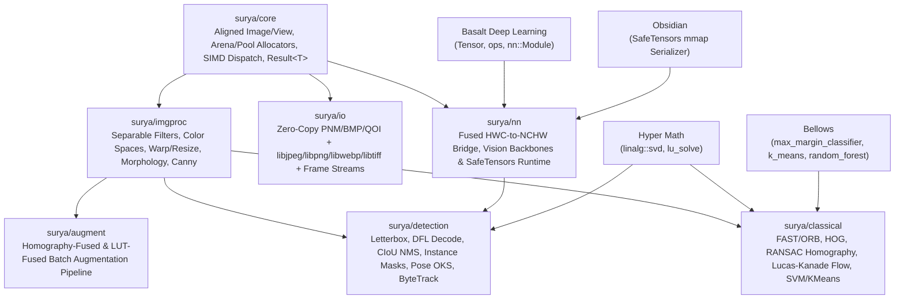

# Knowledge Item: `Surya_Architectural_Decisions`

## 1. Executive Summary & Architectural Philosophy

**Surya** is a clean-room, native C++23 Computer Vision library engineered for low-latency, deterministic, high-throughput production vision pipelines. Rather than wrapping Python frameworks or copying legacy C++98 designs, Surya synthesizes modern hardware-sympathetic idioms—compile-time channel/depth specialization, 64-byte cache-line row-pitch alignment, arena/pool memory recycling, SIMD kernel dispatch, and operator fusion—while selectively integrating four sibling C++ libraries (**Basalt**, **Hyper Math**, **Bellows**, and **Obsidian**) strictly where their domain engines outperform bespoke vision primitives.

---

## 2. Competitive Exploration: Bottlenecks in Existing Vision Frameworks

### 2.1 OpenCV (`cv::Mat`, `imgproc`, `dnn`)
* **Identified Bottlenecks**:
  1. **Implicit Reference Counting (`cv::UMatData` atomic refcount)**: Every `cv::Mat` copy mutates shared atomic reference counters, and mutations silently alias buffers unless `.clone()` is defensively called, causing either unexpected aliasing bugs or defensive deep-copy overhead.
  2. **Runtime-Untyped Access (`CV_8UC3` integer magic macros)**: Channel count and scalar depth are erased by default, forcing runtime `switch(mat.type())` dispatch on every filter call or unsafe `.at<cv::Vec3b>(y, x)` casts.
  3. **Unaligned Row Strides by Default**: Standard `cv::Mat` rows are contiguous (`width * elemSize`) unless allocated with special pitch rules, causing unaligned SIMD loads (`_mm256_loadu_si256`) at every scanline boundary and cache-line splits across row transitions.
  4. **Exception-Heavy Error Reporting (`cv::Exception`)**: Fatal assertions and runtime input errors both throw exceptions, penalizing zero-overhead deterministic paths in embedded and real-time systems.
* **Surya's Solution**:
  - **Explicit Ownership + Zero-Cost Views**: `surya::core::Image<T, C, Layout>` owns its buffer exclusively via move-only or explicit `.clone()` semantics, while `surya::core::Image_View<T, C, Layout>` is a trivially copyable 32-byte non-owning view (`data`, `width`, `height`, `row_stride_bytes`). A runtime-polymorphic `surya::core::Dyn_Image` is provided strictly for I/O boundaries where pixel format is determined by file headers.
  - **Guaranteed 64-Byte Row-Pitch Alignment**: Every row of an owning `Image` is padded to a multiple of 64 bytes (512 bits, matching an x86-64 cache line and an AVX-512 register), guaranteeing that every scanline starts on an aligned boundary (`alignas(64)`) and allowing tail-safe vectorized loops without reading past allocation bounds.
  - **Monadic Error Handling**: Recoverable failures return `surya::core::Result<T>` (`std::expected<T, surya::core::Error>`), reserving assertions strictly for internal invariants.

### 2.2 Torchvision (`torchvision::ops`, `transforms::v2`)
* **Identified Bottlenecks**:
  1. **Planar-First (NCHW) Penalty for Spatial Filtering**: Torchvision represents images as generic 3D/4D `at::Tensor` objects in planar `CHW` format. While `NCHW` is optimal for 2D convolutions with large channel counts ($C \ge 32$), 3-channel RGB spatial operations (bilinear resize, affine warp, bilateral filtering, color space conversion) suffer from 3 separate cache-stream lookups per pixel (R plane, G plane, B plane separated by $H \times W$ bytes), increasing L1D cache misses and TLB pressure.
  2. **Dynamic Tensor Allocation per Transform**: Chaining `Resize -> RandomCrop -> ColorJitter -> Normalize` allocates and materializes an intermediate heap tensor after every single stage.
* **Surya's Solution**:
  - **Compile-Time Dual Layout (`Channel_Layout::Interleaved` HWC vs. `Channel_Layout::Planar` CHW)**: `surya/imgproc` and `surya/augment` operate natively on cache-local interleaved `HWC` (or planar `CHW` when requested), and `surya/nn` provides a **single-pass fused SIMD bridge** (`image_to_basalt_tensor`) that simultaneously performs `HWC -> NCHW` de-interleaving, `uint8 -> float32` conversion, and `(px * scale - mean) / std` affine normalization in one memory traversal.

### 2.3 Albumentations
* **Identified Bottlenecks**:
  1. **Python Per-Stage Dispatch & Intermediate Allocations**: Albumentations dispatches each transform in a pipeline (`HorizontalFlip`, `ShiftScaleRotate`, `RandomBrightnessContrast`, `Gamma`) to separate OpenCV calls, materializing full intermediate images and resampling pixels multiple times (causing cumulative bilinear interpolation blur).
* **Surya's Solution (`surya/augment`)**:
  - **Geometric Homography Fusion**: Consecutive geometric transforms (flip, rotation, scaling, shear, translation, perspective, crop) are algebraically composed into a **single $3 \times 3$ homography matrix** $H_{\text{total}} = H_k \cdots H_2 H_1$. Pixels are resampled **exactly once** from the source image to the destination buffer, eliminating both intermediate allocations and multi-pass resampling blur, while exact forward $H_{\text{total}}$ transforms bounding boxes and keypoints simultaneously.
  - **Photometric LUT Fusion**: Consecutive per-channel 8-bit photometric transforms (brightness, contrast, gamma, solarize, posterize, invert) are composed into a **768-byte ($3 \times 256$) L1-resident Lookup Table (LUT)** applied in a single vectorized pass (or fused directly into the geometric warp output stage).

### 2.4 Ultralytics (YOLOv8 / YOLO11 Pipelines)
* **Identified Bottlenecks**:
  1. **Fragmented Preprocess / Postprocess Glue**: Letterbox padding, HWC-to-NCHW transpose, Distribution Focal Loss (DFL) softmax-integral decoding, IoU computation, Non-Maximum Suppression (NMS), and prototype mask multiplication are scattered across Python/PyTorch tensor ops with high launch and allocation overhead for small batch sizes ($B = 1 \dots 4$).
* **Surya's Solution (`surya/detection`)**:
  - **End-to-End Native C++ Detection Primitives**: `Letterbox_Transform` computes exact reversible scale + pad parameters and writes directly into a pre-allocated buffer; `decode_dfl_boxes` fuses 16-bin softmax + integral projection with anchor-grid decoding in a single SIMD loop; `ciou_nms` and `decode_instance_masks` execute in pre-allocated arena memory with zero heap allocations per frame.

---

## 3. Module Boundaries & Responsibilities

---

## 4. Conditional Custom Library Integration Matrix & Rationale

Per the Surya architectural mandate, sibling custom libraries are integrated **only when they are the optimal architectural choice** for a subsystem:

| Subsystem | Custom Library Used | Specific Components Integrated | Architectural Justification |
| :--- | :--- | :--- | :--- |
| **`surya/core`** | *None (Bespoke Surya)* | Native `Image<T, C, Layout>`, `Image_View`, `Aligned_Buffer_Pool`, `Arena_Allocator` | General N-D tensors (`basalt::Tensor` or `hyper_math::nd_tensor`) track arbitrary dynamic dimensions/strides on the heap and lack compile-time channel count specialization (`C = 1, 3, 4`) and guaranteed 64-byte row-pitch padding required for scanline SIMD vision kernels. |
| **`surya/imgproc`** | *None (Bespoke Surya)* | Native AVX2 / cache-blocked 2D vision kernels | Vision filtering (separable 2D convolution, van Herk morphology, fixed-point color conversion, inverse-mapped bilinear warps) requires tight 2D row-strided scanline loops and L1 cache blocking tailored to `Image_View`. |
| **`surya/io`** | *None (Bespoke Surya + system codecs)* | Native mmap PNM/BMP/QOI + `libjpeg`, `libpng`, `libwebp`, `libtiff` | Image codecs decode directly into Surya's 64-byte row-aligned `Image` buffers via row-pointer tables (`png_read_image`, `jpeg_read_scanlines`), avoiding intermediate tensor copies. |
| **`surya/augment`** | *None (Bespoke Surya)* | Native $3 \times 3$ homography & $3 \times 256$ LUT fusion engine | Unrolled $3 \times 3$ matrix multiplication is 27 scalar FMAs on stack registers; invoking a heap-allocated N-D tensor library for $3 \times 3$ composition would add unnecessary dynamic allocation overhead. |
| **`surya/nn`** | **Basalt** & **Obsidian** | `basalt::Tensor`, `basalt::nn::Module`, `basalt::nn::Conv2d`, `basalt::nn::BatchNorm2d`, `obsidian::SafeTensors_File`, `obsidian::load_module_safetensors` | **Basalt** already provides a full reverse-mode autograd engine, Im2Col+GEMM `Conv2d`, `BatchNorm2d`, and activation kernels. **Obsidian** provides a verified POSIX `mmap(2)` zero-copy `.safetensors` loader with automatic `F16`/`BF16` $\to$ `F32` conversion. Reimplementing autograd or SafeTensors would duplicate thousands of lines of tested infrastructure. |
| **`surya/detection`** | **Hyper Math**, **Basalt**, **Obsidian** | `hyper_math::scientific::linalg::lu_factor`, `lu_solve`, `inv` (Kalman gain $K = P H^T (H P H^T + R)^{-1}$ in `Byte_Tracker`); `basalt::nn::Module` for detector inference | Multi-object Kalman tracking (`Byte_Tracker`) requires numerically stable $8 \times 8$ / $4 \times 4$ state covariance linear solves with partial pivoting (`lu_factor` / `lu_solve`), where **Hyper Math** provides a battle-tested Doolittle LU solver. Bounding-box IoU and NMS remain bespoke Surya SIMD kernels for zero-allocation speed. |
| **`surya/classical`** | **Bellows** & **Hyper Math** | `bellows::max_margin_classifier` (SVM), `bellows::k_means_clusterer` (BoVW / quantization), `bellows::random_forest_classifier`, `bellows::data_table`; `hyper_math::scientific::linalg::svd` & `lstsq` (DLT Homography in RANSAC) | Direct Linear Transform (DLT) homography estimation inside RANSAC requires Singular Value Decomposition ($A = U \Sigma V^T$) of an $8 \times 9$ or $2N \times 9$ system, for which **Hyper Math**'s Golub-Kahan SVD (`linalg::svd`) is ideal. Classical feature classification (HOG + SVM pedestrian detection, ORB Bag-of-Visual-Words clustering) delegates directly to **Bellows** estimators via a zero-overhead descriptor-to-`bellows::data_table` adapter. |

---

## 5. Rejected Transliteration Approaches

1. **Rejected: OpenCV `cv::InputArray` / `cv::OutputArray` Type-Erased Proxy Hierarchy**:
   - *Why rejected*: Incurred dynamic dispatch, hidden allocations via `.create()`, and loss of compile-time type safety. Replaced by C++20 concepts (`surya::core::image_surface`, `surya::core::writable_image_surface`) and overloaded functions returning `Result<Image<...>>` or writing into pre-allocated `Image_View<...>` destinations.
2. **Rejected: Albumentations Object-Oriented Virtual `BasicTransform` Hierarchy**:
   - *Why rejected*: Virtual calls per image and inability to inspect adjacent pipeline stages for algebraic fusion. Replaced by `Augment_Pipeline<Stages...>` using `std::tuple` compile-time introspection (`is_geometric_stage_v<Stage>`, `is_photometric_lut_stage_v<Stage>`) and a flat instruction-tape `Augment_Graph` for runtime pipelines.
3. **Rejected: Ultralytics Python-Style Dict-of-Tensors Detection Results**:
   - *Why rejected*: Heap-allocated string maps and untyped tensor slices hurt cache locality in real-time C++ loops. Replaced by cache-aligned POD structs (`Detection_Box`, `Pose_Keypoint`, `Detection_Result`, `Tracklet`) stored in `std::pmr::vector` or stack-friendly contiguous buffers.
